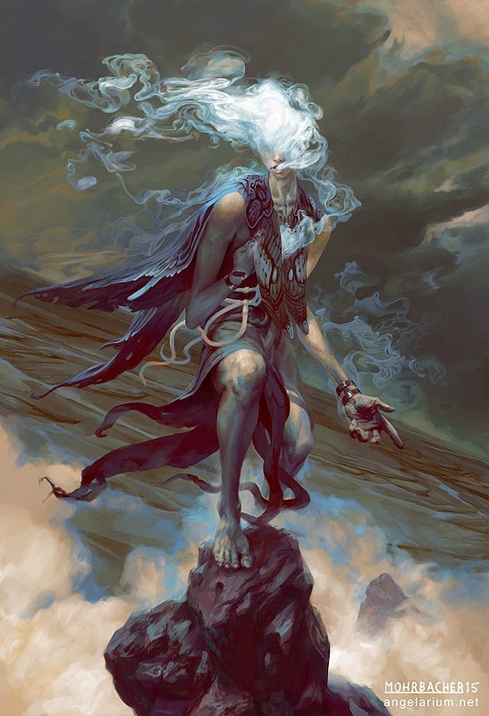

title: Ше`Ел
parent: bozhestva
order: 90
icon: bi-brightness-high
group: Средние божества
summary: Бог холода, правосудия, выносливости и упорства
image: photo/bogi-web/she-el.webp
vk: 54763118
art: photo/bogi-web/she-el.webp
layout: god
portrait: photo/vk/552910068_457239414.jpg
aliases: tir

## Ше`Ел: бог холода, правосудия, выносливости и упорства

_Среднее божество._

Ше`Ел — старший сын Верховного божества, по праву занимающий своё место в пантеоне богов Наира. Рождённый, он сразу был сброшен с небес на только образовавшиеся горы Наира, вынужденный перенести суровость бренного мира в смертной оболочке. Но проявить лишь физическое упорство было меньшим из того, что перенёс Ше`Ел. Ему было суждено пережить предательство брата, воспользовавшегося тем, что его родственник был в смертной оболочке. Хирик был жаден до власти в пантеоне и хотел большего, например, забрать титулы братца. Выпросив у Турна, бога кузнечества, кандалы, он заковал в них Ше`Ела, заключённого в смертной оболочке. Пропитанный ужасной злобой, Ше`Ел лишь ждал. Заключение превратилось в суровое испытание, длившееся столько лет, сколько людскому роду ещё нет. Холодная злость окутала горы в снежные шапки, а кандалы заставила покрыться коркой льда. Даже изобретение бога Турна не выдержало натиска Ше`Ела, лопнув на несколько частей. Ше`Ел вернулся в пантеон, с целью призвать к правосудию своего нерадивого братца. Только изобретательная ложь и изворотливость змеи помогли последнему избежать этого.

Ше`Ел — один из немногих богов, которого активно изображают в двух различных ипостасях: смертной оболочке и божественной. В первой он представляется как крупный волк, часто заключённый в кандалы. Шерсть его часто изображают покрытой льдом, или вовсе им заменённой. В божественной же своей форме Ше`Ел менее грозный. Долговязое тело окружено леденящей кровь дымкой, а из одежд лишь скромная накидка, походящая материалом на волчью шкуру. Взгляда он, как и многие боги, не имеет. Вместо этого от верхней части его головы как раз струится ледяной дым.
