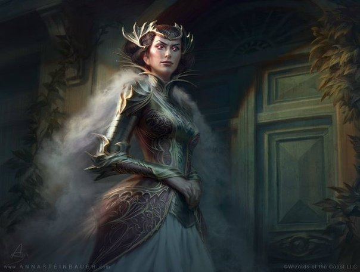

title: Арайя Брей
parent: vazhnye-personazhi
order: 10
icon: bi-person-badge
group: Правители
image: photo/vk/533473434_457251314.jpg
vk: 54837818
art: photo/vaznye-web/arayya-brey.webp
portrait: photo/vaznye-web/arayya-brey.webp
layout: person

**Известное имя** — Арайя Илажэ Брей

**Примерный возраст** — 34 года

**Раса** — Человек

**Статус** — Правитель Империи людей

## Характер и известные деяния

Как и почти все дети из высших слоёв, многим юная Арайя помнится избалованной особой, которая всегда найдёт способ добиться своего. Сейчас же явно стали видны учения лучших людей, что были в Империи. Уже при власти пробились её спокойствие и терпение, о которых раньше мало кто мог подумать. Также раскрылись отличные навыки стратега и политика. В свободное время молодая императрица тренируется с луком и мечом, продолжая совершенствовать свои навыки, что известный факт. Все её действия в управлении страной пока что взвешены и разумны. Несмотря на избалованность в детстве, девушка прислушивается к мнению близких людей и легко поддается обучению, не прекращая его до сих пор. Очень красноречива и грамотно ведёт диалог, особенно с представителями других стран. Печально известна своей мстительностью и злопамятностью, но у власти это скорее идёт ей в плюс.

## Внешность

Арайя очень статная и весьма красивая женщина. Черты лица аккуратные и округлые, в целом приятные глазу. Среднего роста в 179 см. Не очень длинные тёмные волосы всегда любит собирать в однотипную причёску, украшая при возможности её диадемой в виде двух крыльев дракона. Одевается она соответственно своему статусу, довольно дорого и красиво, всегда представая в удобных платьях. При ней довольно часто виден знаменитый артефакт — клинок душ.
