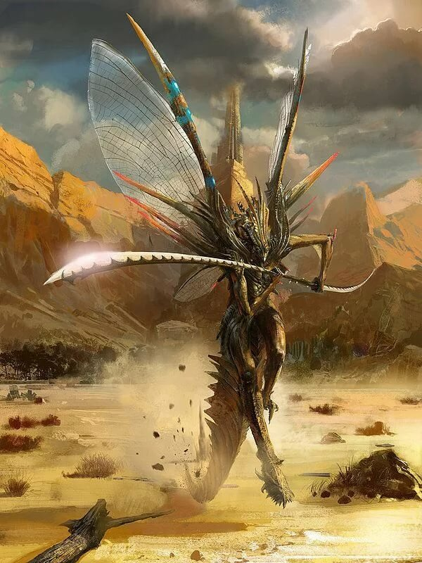

title: Борканог
parent: vazhnye-personazhi
order: 100
icon: bi-person-badge
group: Лидеры организаций
image: photo/vk/533473434_457251325.jpg
vk: 54874234
art: photo/vaznye-web/borkanog.webp
portrait: photo/vaznye-web/borkanog.webp
layout: person

**Известное имя** — Борканог

**Примерный возраст** — От 200 и более лет

**Раса** — Насекомоподобный

**Статус** — Лидер ордена Веры

## Примерный характер и деяния, что сделали его известным

Является действующим лидером ордена "Веры". В общении и действиях он резок и прямолинеен, не любит ждать чего-либо. Прекрасный стратег и чудесный лидер. Хорошо разбирается в политике и экономике.

## Внешность

Борканог напоминает и стрекозу, и богомола. Высокий рост в 278 см, крылья размахом до 1 метра, такой же длины хвост и большие шипы рядом с крыльями делают из него довольно страшное на вид существо, которое уж точно вселяет страх во врагов. Хитиновый слой за всю жизнь Борканога становился всегда лишь крепче, и сейчас сравним по прочности с латами, что делает мечи практически бесполезными в битве с ним. Хитин имеет множество сколов и трещин, что прибавляет устрашения к внешности Борканога. Несмотря на такую прочность своих природных лат, он не чурается использовать в некоторых случаях ещё и сами латные щитки, защищающие особо уязвимые места.
