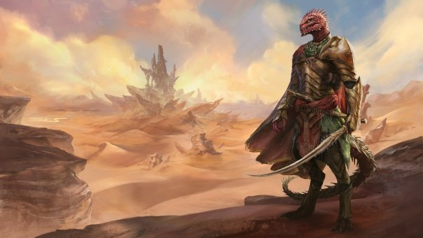

title: Джаар'Иль Кармль
parent: vazhnye-personazhi
order: 40
icon: bi-person-badge
group: Правители
image: photo/vk/533473434_457251317.jpg
vk: 54837825
art: photo/vaznye-web/dzhaar-il-karml.webp
portrait: photo/vk/533473434_457251313.jpg
layout: person

**Известное имя** — Джаар'Иль Кармль

**Примерный возраст** — 47 лет

**Раса** — Ящеролюд

**Статус** — Император Великой Империи ящеров.

## Характер и известные деяния

Джаар, как и все в королевской семье ящеров, с детства воспитывался для роли Великого императора. Он учился стратегии боя, многим наукам и знает много языков. Также ящер набожен. Красная чешуя будто выдаёт скрытую жестокость и кровожадность. Собственноручно Император не брезгует пытать тёмных магов, в особенности женщин. Выпытывая для себя нужную информацию, он не брезгует вырвать ногти жертве или причинить невыносимую боль благодаря отличному знанию строения тела. Всё это известно из слухов при дворе. Жестокость не мешает ему добротно управлять страной, пребывающей сейчас в процветании. Даже необдуманные на первый взгляд действия приводят к положительной ситуации. В общении ящер сдержан и ведёт себя крайне культурно, разговаривая со всеми на "вы", вне зависимости от статуса собеседника. Также у императора огромное пристрастие к охоте на хищных животных.

## Внешность

Джаар довольно высокий (198 см) ящер, с редко встречающейся красной чешуёй, сразу бросающейся в глаза. В области челюсти есть шипы, которые многие ящеры безболезненно удаляют. Глаза зелёного цвета, с отливом жёлтого. Одевается Император довольно богато и напоказ, о чём можно судить по одним золочёным доспехам правителя, предназначенным для охоты. Имеются довольно большие и острые когти, которые многие обычно также стараются убирать и постоянно подстригать, однако в этом Кармль видит особую красоту.
