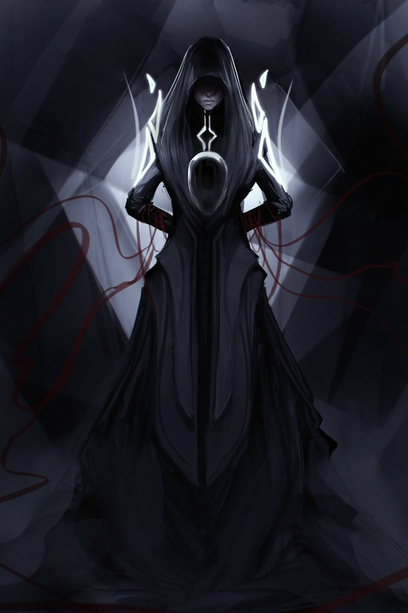

title: Ханда
parent: vazhnye-personazhi
order: 80
icon: bi-person-badge
group: Лидеры организаций
image: photo/vk/533473434_457251323.jpg
vk: 54874230
art: photo/vaznye-web/handa.webp
portrait: photo/vaznye-web/handa.webp
layout: person

**Известное имя** — Ханда Калин

**Примерный возраст** — Предположительно 70-110 лет

**Раса** — Человек

**Статус** — Лидер гильдии "Белые последователи Малайи"; Один из архимагов Бранна.

## Примерный характер и деяния, что сделали его известным

Является лидером гильдии "Белые последователи Малайи", предположительно один из архимагов Бранна. Холодна и рассудительна, в диалогах не особо многословна, держит грань между словесным мусором и отсутствием слов в принципе.

## Внешность

Довольно много людей помнят, какова была Ханда в молодости, и лишь по этим данным можно о ней судить, так как с момента главенства в гильдии женщина не появляется просто так на людях, а внешность скрывает, как и большинство участниц гильдии, — за маской и скрывающими тело нарядами. Черты лица довольно топорные, кое-где даже грубоваты, однако выглядит молодо для своих лет. Глаза имеют приятный зеленовато-изумрудный цвет. Волосы были довольно светлые и длинные, однако что сейчас происходит с причёской Ханды, неизвестно. Почти всегда появляется в чёрных мантиях, которые мало чем отличаются друг от друга, а также в маске. Ростом около 1.87 метра.
