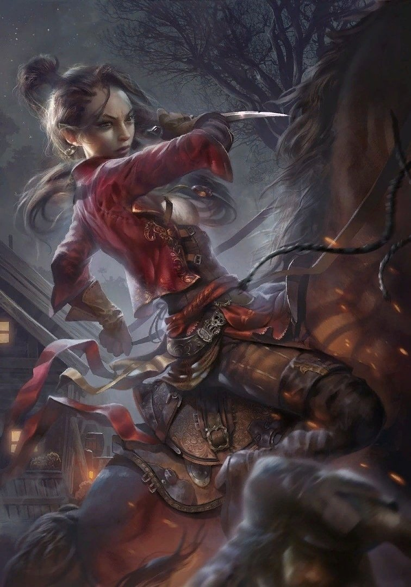

title: Искра
parent: vazhnye-personazhi
order: 70
icon: bi-person-badge
group: Лидеры организаций
image: photo/vk/533473434_457251322.jpg
vk: 54873721
art: photo/vaznye-web/iskra.webp
portrait: photo/vaznye-web/iskra.webp
layout: person

**Известное имя** — Гатея Браум; Искра

**Примерный возраст** — около 20-26 лет

**Раса** — Внешне напоминает эльфийку Алькара.

**Статус** — Лидер и основатель гильдии "Залив теней".

## Примерный характер и деяния, что сделали его известным

Хитрая как лиса, способна повернуть любой диалог под свои нужды. Может запросто добыть информацию из разговора, если это потребуется. Но имеются серьёзные перемены в желаниях, может гнаться за целью часами, а после переключиться на что-то ещё, не обращая внимания на прошлую задачу. Можно выделить падкость к деньгам и дорогим побрякушкам.

## Внешность

Искра предстаёт внешне как хрупкая девушка, достаточно низкого роста в 167 см, с аккуратной талией. Голову украшают длинные русые волосы, которые чаще всего девушка собирает в большой хвост. Как и все эльфы Алькара, имеет довольно небольшие, суженные глаза, а также довольно небольшие для эльфов Бранна уши, более заострённые у кончиков. Нос, подбородок и черты лица в целом довольно острые, смотрящиеся при этом крайне аккуратно. Глаза коричневого цвета. Одевается в основном в удобную одежду, в которой и подраться будет удобно, в случае чего. Из-за этого во многом кажется, что одевается она просто и внешний вид для неё на втором плане, хотя и стоит каждый элемент её гардероба немалую сумму — только лучшие материалы из Алькара.
