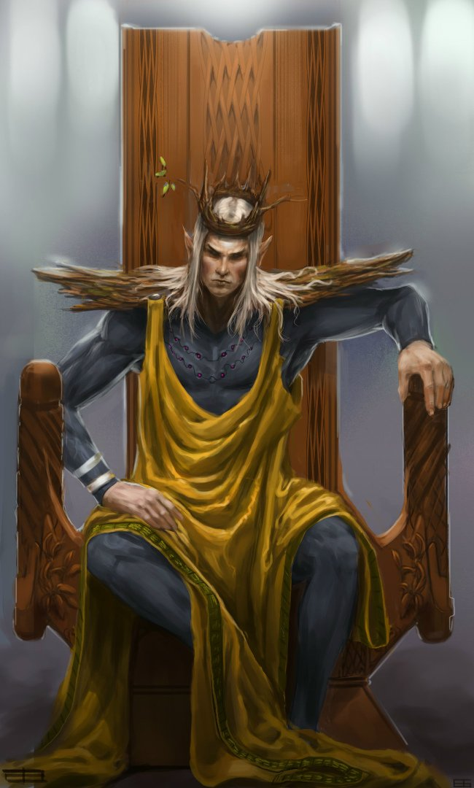

title: Итилгаил Аел Ют Белегестер
parent: vazhnye-personazhi
order: 30
icon: bi-person-badge
group: Правители
image: photo/vk/533473434_457251316.jpg
vk: 54837822
art: photo/vaznye-web/itilgail-ael-yut-belegester.webp
portrait: photo/vaznye-web/itilgail-ael-yut-belegester.webp
layout: person

**Известное имя** — Итилгаил Аел Ют Белегестер

**Примерный возраст** — 112 лет

**Раса** — Эльф

**Статус** — Король эльфов. Также является одним из эльфийских мастеров меча.

## Характер и известные деяния

Белегестер известен своей постоянной холодностью, спокойствием и даже безэмоциональностью. Первое впечатление является правдивым. С приходом к власти с каждым днём будто угасала некая искра жизни в Итилгаиле, присущая не обременённым властью. Эта эмоциональная смерть будто подчёркивает эльфийское высокомерие в их короле. Однако такое состояние короля пока никак не сказывается на состоянии страны, скорее наоборот. Не хвастающийся особыми стратегическими умениями, он имеет двух полководцев, которые и руководят действиями армии, однако в основном подчиняются королю. Во внутренних делах альянса управляется прекрасно, не чурается просить совета у Хранительниц. Многие знают о его абсолютной ненависти к людям и всем зелёнокожим. При его управлении все они убиваются в лесах без предупреждения. Именно он инициировал показательное уничтожение пары деревень близ лесов эльфов, как элемент запугивания людей, ещё в начале своего правления.

## Внешность

Внешне Итилгаил — атлетичный мужчина со спортивным телом, не выдающим преклонный возраст владельца. Имеет белые волосы до плеч, зелёные глаза и весьма топорные для эльфа черты лица, не присущие его расе. Одевается в меру скромно и при этом не безвкусно, всегда хорошо выглядя в любое время. В основном это длинные одежды, порой волочащиеся по полу. Почти всегда голову украшает корона, сделанная из веток Мирового Древа.
