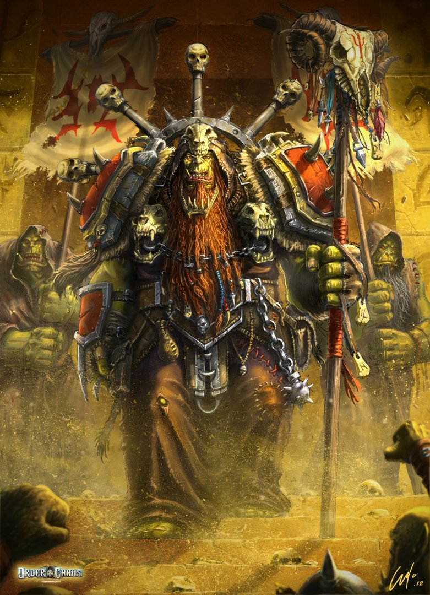

title: Корог Медведь
parent: vazhnye-personazhi
order: 50
icon: bi-person-badge
group: Правители
image: photo/vk/533473434_457251318.jpg
vk: 54837831
art: photo/vaznye-web/korog-medved.webp
portrait: photo/vaznye-web/korog-medved.webp
layout: person

**Известное имя** — Корог Медведь

**Примерный возраст** — 52 года

**Раса** — Орк

**Статус** — Вождь Гром'Ха

## Характер

Мудрый, рассудительный и, конечно же, яростный в бою, Корог уже долго правит кланом Гром'Ха, заслужив авторитет среди небольшого круга орков. Непривычно мягкий в отличие от многих, этот орк полностью отдаёт себя клану, грезя мечтами развития орочьей расы. Очень хорошо для орка разбирается в политике, что помогает ему избежать необдуманных решений на территории Корваса, да и в принципе существовать тут. Излишне осторожен, но не консервативен. Под своим началом стал принимать в Гром'Ха гоблинов, помогающих его развитию. Но при всём этом хороших манер при общении от него ждать не стоит.

## Внешность

Крупный орк с ростом около 324 см и длинной рыжей бородой, собранной в отдельные косички. На правой руке всегда носит наруч с когтями, как оружие самозащиты в любых случаях. Часто к спине прикрепляет украшение в виде стального знака с черепами на кольях. Такой внешний вид должен внушать понимание того, кто тут главный и по чьим правилам все будут играть. Одевается же относительно просто, ведь какие-то дорогие одежды в принципе чужды многим оркам, хотя исключения, конечно, есть.
