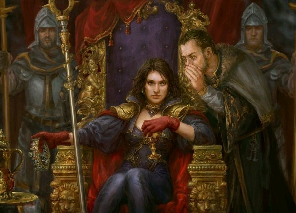

title: Миет Ла'кармэаль
parent: vazhnye-personazhi
order: 20
icon: bi-person-badge
group: Правители
image: photo/vk/533473434_457251315.jpg
vk: 54837820
art: photo/vaznye-web/miet-la-karmeal.webp
portrait: photo/vaznye-web/miet-la-karmeal.webp
layout: person

**Известное имя** — Миет Ла'кармэаль

**Примерный возраст** — 32 года

**Раса** — Человек

**Статус** — Правитель страны Граальдфад — союзника Империи людей.

## Характер и известные деяния

Будучи младшей дочерью правителя, она была последней, кто мог занять престол. Однако из-за трагичной смерти старшего брата и последующего ухода сестры из дома, Миет стала следующей, кто после отца будет править великим Граальдфадом. Перед этим девочкой, естественно, занимались лучшие. Уже к моменту восхождения на престол она разбиралась в политике, экономике, частично в военной стратегии и тактике. С рождения у неё отмечался грубый характер и завышенное чувство справедливости. При приходе к власти всё это только обострилось. Жёсткий характер Ла'кармэаль нашёл своё отражение в обществе. Все преступники казнятся публично, что стало традицией и забавой на площадях для всех семей.

> Обезглавить. Нет. Нужно что-то более изящное и мучительное. И, конечно же, прилюдное, у людей должен быть пример.

## Внешность

Миет выглядит довольно простой девушкой, с волнистыми чёрными волосами, округлыми чертами лица и серыми глазами. Ростом около 170 см. Она не очень любит вычурно наряжаться, даже носить по праву принадлежащую себе корону. Предпочитает удобные одежды, почти всегда отказываясь от платьев. Она не выделяется мускулатурой, ведь достаточно слаба телом с детства. Многие считают, что именно из-за травм она часто появляется с посохом на публике, на который просто опирается.
