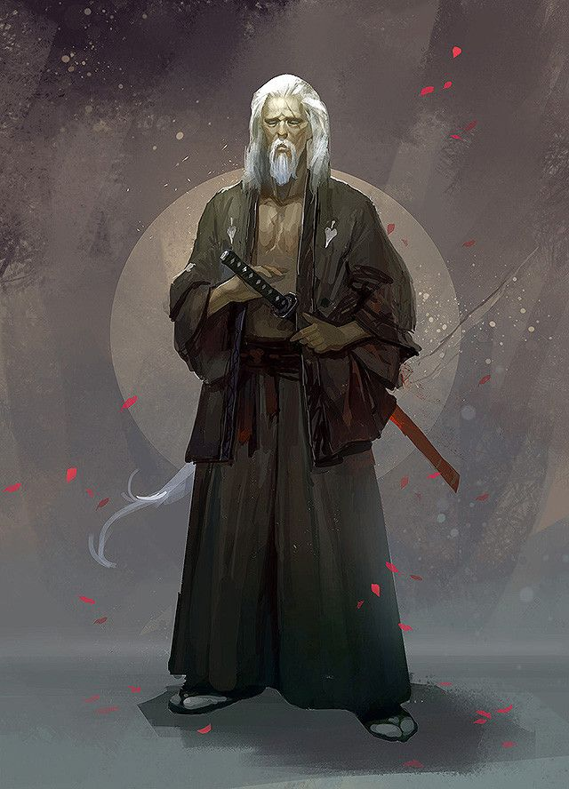

title: Нибб
parent: vazhnye-personazhi
order: 90
icon: bi-person-badge
group: Лидеры организаций
image: photo/vk/533473434_457251324.jpg
vk: 54874232
art: photo/vaznye-web/nibb.webp
portrait: photo/vaznye-web/nibb.webp
layout: person

**Известное имя** — Нибб Руат

**Примерный возраст** — Около 85-90 лет

**Раса** — Человек;

**Статус** — Лидер ордена Золотого Дракона

## Примерный характер и деяния, что сделали его известным
Является действующим лидером ордена "Золотого Дракона". Умён не по годам, добр и приятен в общении. В своём ордене скорее помогает тем, кто ниже, чем командует им.

## Внешность

Нибб уже очень старый, можно сказать, что даже на закате своих сил, что, конечно, отражается внешне. Множество морщин, ярко выраженные скулы и седые волосы до плеч. На лице имеется шрам, проходящий через глаз, который был получен ещё в молодости во время тренировок. Однако, несмотря на возраст, выглядит Руат довольно подтянутым, видны тренировки, которые шли бок о бок со всей жизнью старца. Одеваться также предпочитает довольно просто, исключая случаи особых событий или церемоний, когда Нибб надевает довольно дорогие одеяния или вовсе доспехи, всегда при этом имея при себе своё оружие.
