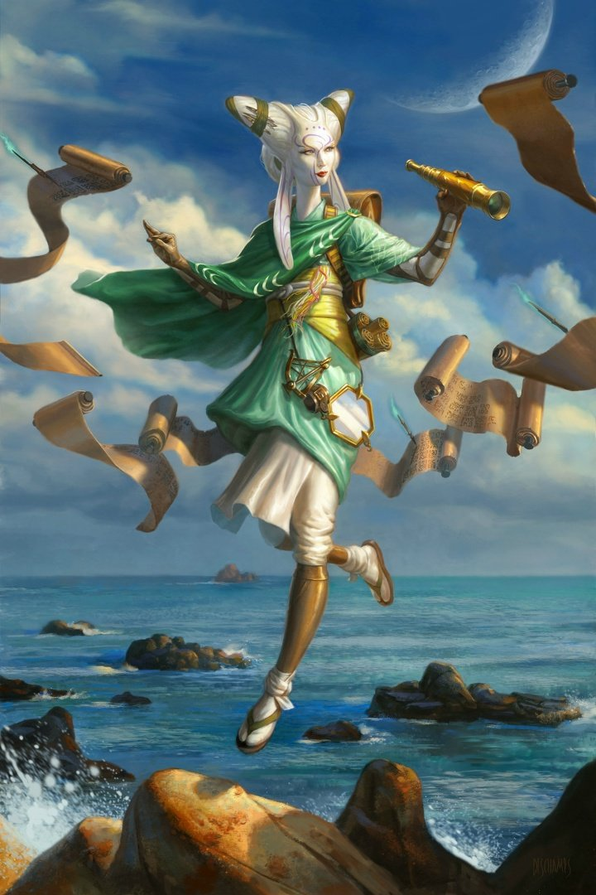
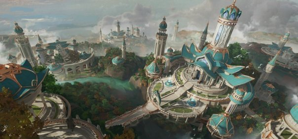

title: Аанари
parent: rasy
order: 180
icon: bi-person
image: photo/vk/533473434_457251167.jpg
layout: race
art: photo/race/aanari-card.jpg
art_position: center 18%
group: Другие расы
vk: 55317371

## Общее описание

Аанари — вымирающая из-за своей миролюбивости раса, родиной которых являются Архипелаги на юге Наира, значительно удалённые от большинства материков океаническими водами. Историки и любители искусства по своей натуре, они ставили главной своей целью достижение благополучия своей расы, на удивление быстро развиваясь при удалении от более крупных цивилизаций.

## Названия

Аанари, Лаариды (наиболее частое название в Натаирском языке, отличающееся от всеобщего).

## Внешность, строение и особенности

Океанические жители представляют собой человекоподобных существ, сильно выделяющихся белоснежной, порой сине-серой кожей, а также очень длинными ушами, помимо прочего выполняющими иные функции. Зачастую стройны и высоки от природы, практически не обладая внешними изъянами от рождения. Минимальный рост аанари — 200 см, при среднем весе в 60-75 кг. Кожа их обладает природными узорами, которые реагируют на сильные проявления магии, начиная излучать свечение. Наибольшая концентрация узоров на лицах, ушах и конечностях. Аанари сверхчувствительны к магии, а также и сами хорошо ею владеют. Каждый лаарид от рождения может владеть магией. Из-за особенностей восприятия магических потоков последние при большой концентрации могут сильно навредить здоровью аанари. В первую очередь повреждаются нервная система и головной мозг.
Сама черепная коробка и устройство мозга крайне необычны. Черепная коробка не покрывается кожей, вместо этого обрастая роговидным прочным покрытием, различным у каждого аанари. Роговидное покрытие помимо прочего обрастает густыми волосами, всегда белого цвета. Длинные уши помимо прочего наделены специальными органами вдоль всей длины, помогающими в совершенстве ощущать магические потоки.
Живут в среднем от 32 до 45 лет _(с учётом всех факторов типа детской смертности)_. Аанари, выросший до самостоятельного возраста, живёт в среднем 65-80 лет. Максимальный возраст жизни 110 лет.

Аанари довольно слабы физически, но их мозг больше человеческого на 20%, а также куда быстрее обрабатывает информацию и в целом более совершенен, чем у большинства разумных существ. Их глаза малы и заужены, а остальные черты лица весьма аккуратны, несколько теряясь на общем фоне. Пальцев на ногах часто вместо пяти всего два. Аанари обладают не столь хорошим зрением, различают основные цвета, но отличают меньше тонов. Различают ультрафиолет. Являются долгожителями, в среднем проживая 200-400 лет. Старость не проявляется сильно внешне. Женщины способны к зачатию лишь в определённый период в году, длящийся всего пару месяцев. Само вынашивание плода занимает больше года, но рождается в среднем 2-3 ребёнка.

## Культура, типичное поведение, положение среди остальных и места обитания

Аанари от природы миролюбивы и любознательны. Живущие на дальних островах, они спокойно развивали своё общество, изредка проникая в чужие цивилизации для пополнения собственных свитков и томов, создавая летописи. Государство Аанари презирает милитаризм и само никогда не было готово к войнам, наивно полагаясь на свою недосягаемость на архипелаге. Поэтому когда предстала угроза в виде военной машины Натаира, настали тяжёлые времена для расы лааридов. В первые дни вторжения воинственных эльфов аанари потеряли несколько крупных городов и тысячи мирных жителей. По сей день фронт сдвинулся к столице Аанари, которая стоит на отдельном острове перед остальными островами, ещё оставшимися под контролем лааридов. Для мирных историков и любителей искусства стоит реальный риск вымирания.

Немногочисленные Аанари быстро развивались, и их столица Лакранем — один из величайших городов, которые только можно увидеть. Аанари сильнее всего увлечены всевозможным искусством, а также историю. Даже магию они обратили в искусство, а сами Аанари, очень редко встречающиеся где-либо, при этом хранят истории чуть ли не со всех концов мира в великой библиотеке Лакранема.
