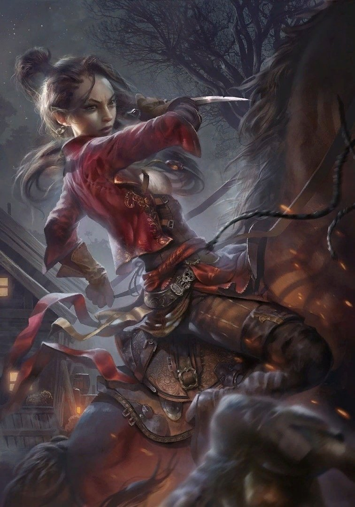

title: Алькарцы
parent: rasy
order: 50
icon: bi-person
image: photo/vk/533473434_457251154.jpg
layout: race
art: photo/race/alkarcy-card.jpg
art_position: center 25%
group: Эльфы
vk: 55340433

## Общее описание

Наиболее частые гости в Бранне среди других видов эльфов. Самые добродушные и простые из всех эльфов, ошибочно напоминающие смесь человеческих и эльфийских кровей. Считаются самой молодой подрасой эльфов, которые когда-то переселились в более степные, жаркие зоны.

## Названия

Алькарцы, ходуны (из-за любви к постоянному перемещению и кочевому образу жизни, а также активному "хождению" по морям, часто с целью пиратства).

## Внешность, строение и особенности

Алькарцы резко контрастируют со всеми остальными эльфами. Они очень низкие, порядка 160 см. При этом так же, как и эльфы Бранна, не выделяются хорошей физической силой. Живут меньше всех эльфов, около 100 лет.
Живут в среднем от 32 до 45 лет _(с учётом всех факторов типа детской смертности)_. Алькарец, выросший до самостоятельного возраста, живёт в среднем 65-80 лет. Максимальный возраст жизни 100 лет.
Обладают лучшей среди всех выносливостью, что позволяет долго выдерживать различные нагрузки или продолжительный бег. Внешность у них больше азиатского типа. Тёмных цветов волосы, редко особо большой длины. Кожа их более смуглая, иногда обладает желтоватыми оттенками, а также более грубая. Глаза заужены, в основном зелёных или коричневых цветов. Зрением, к слову, обладают отменным. Уши их всё так же заострённые, но значительно меньших размеров, в отличие от остальных эльфов. Ловкость и проворность остались при них, а вот магический потенциал уже намного меньше.
Алькарцы выделяются крепким здоровьем и хорошей переносимостью различных внешних факторов, от различных температур, до перепадов давления. Ещё одно яркое отличие — обострённость всех чувств. Хорошее зрение, отличный слух и более тонкое восприятие запахов и вкусов. Всё благодаря складу ума, который также отлично адаптируется под различные ситуации, из-за чего эльфы алькара выделяются хорошей смекалкой и интуицией. Они даже могут отличить самую хорошую иллюзию от реальности. Своей приспосабливаемостью к окружению сильно схожи с людьми.

## Культура, типичное поведение, положение среди остальных и места обитания

Наибольшее скопление этих эльфов — в их родной стране, Алькаре, что логично. Однако и по всему миру встречаются они довольно часто. Алькар, как государство, многонационально, и состоит не из одних лишь эльфов, хотя они, конечно, там главенствуют. Такая их открытость и способность к спокойному сосуществованию с другими даже внутри своего государства не может не сказываться и на отношении к ним. У них почти нет заклятых врагов, много где, наоборот, рады этим отличным рассказчикам и деловым ребятам, часто отлично дополняющим весёлую попойку среди людей или гномов. Они всегда открыты, готовы к новым общениям, но главное — они всегда ещё более заинтересованы в возможности заработать. Своей жадностью и стремлением к роскоши алькарцы могут переплюнуть кого угодно. Нацепить на себя побольше золотых блестящих вещей и быть хорошо одетым для них — само собой разумеющееся. При этом они отлично балансируют между вычурностью и действительно достойной, дорогой и, главное, качественной вещью. В этом плане они считают себя аристократичнее многих. Да и утончённые вкусы в алкоголе и еде этому способствуют. Хотя напиться дешёвой дрянью они при этом тоже не гнушаются.
К эльфам Бранна или дриадам они относятся не лучшим образом. Те, кто изолируются от остального мира — для них дураки, ведь мир — возможность зарабатывать. Поэтому с теми же эльфами Бранна они весьма охотно ведут торговлю, ведь лесная братия торгуется лишь с иными эльфами. Иными словами, для алькарцев нет особых принципов или моральных устоев. Убийство, исключая убийства себе подобных или внутри страны, не осуждается. Даже работа многих борделей в их государстве часто финансируются властью. В этом деле, к слову, они большие умельцы, если верить слухам.
