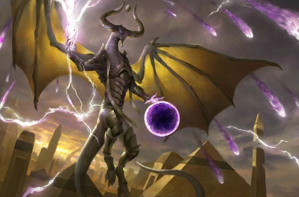
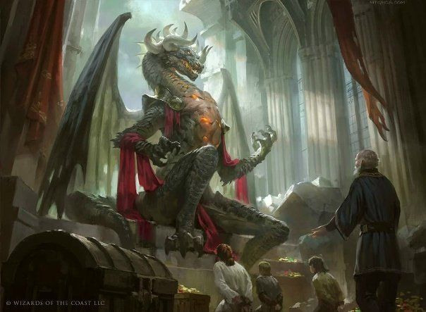
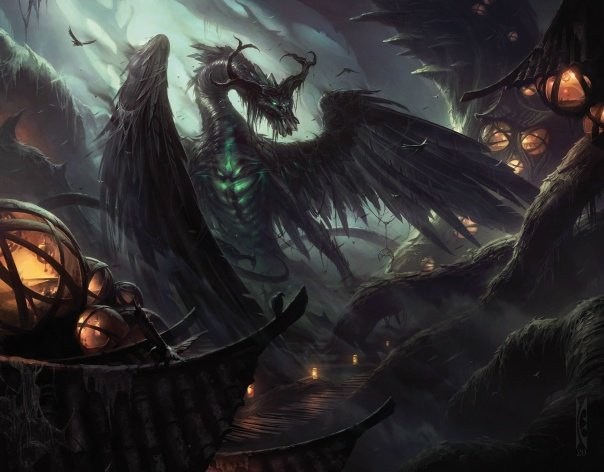

title: Драконы
parent: neigrovye-rasy
order: 10
icon: bi-fire
image: photo/vk/533473434_457251205.jpg
layout: race
art: photo/race/drakony-card.jpg
art_position: center 35%
summary: Одни из сильнейших существ в мирах богов Наира
vk: 55317456

**Ваш персонаж может знать от силы 2 процента информации, что здесь представлена!**

## Общее описание

Драконы — одни из сильнейших существ, что проживают в мирах богов Наира. На пике своего развития они нашли возможность открывать разломы меж миров, оставив тем самым свой след в культуре эльфов Бранна. Они нашли способы жить вечно, дабы их души не достались богам, а последние вынуждены пытаться сдерживать одних из сильнейших существ, которые стремятся сбросить власть своих создателей.

## Названия

Драконы, Ае`лан (с эльфийского — высшие создания).

## Внешность, строение и особенности

Драконы воистину исполины, а разнообразие их столь велико, что свести их к единой усреднённости невозможно. Человек не достигнет ростом и когтя самого большого из драконов. Если брать средних особей, которых, конечно, большинство, то цифры варьируются в пределах 30-40 метров в длину. В целом представляют из себя пресмыкающихся, обладающих 6 конечностями, включая крылья. Тела их не столь массивны, но мускулисты и вытянуты. Тело покрыто плотной и прочной чешуёй, при этом, однако, мало весящей, дабы не мешать полёту. Кости, всё при той же прочности, как и мышцы, также на удивление весьма легки. Помимо лёгких, есть воздушные мешки, а первые представлены сразу несколькими парами. Два больших восьмикамерных сердца — также одни из самых массивных органов, призванных обеспечить возможность полёта. Задние лапы мощнее передних, обеспечивают полёт с места совершением сильных рывков. Передние же лапы больше напоминают руки, а 3-5 пальцев более приспособлены для хватания предметов и прочих манипуляций.
Драконы поголовно прирождённые маги, а их потенциал в магии просто невероятен смертному уму. К слову о смертности, драконы нашли секрет бессмертия в ходе долгих тысяч лет, дабы сберечь свои души от богов Наира.

## Культура, типичное поведение, положение среди остальных и места обитания

Драконы сильно уникальны в своих характерах, а также у каждого сильнее всего выделяется определённая черта. Но всех их всегда объединяла нелюбовь к богам, а также вынужденное пребывание их душ в лабиринтах Иштама после смерти. Бессмертием они не ограничились в своих целях, и поныне драконы пытаются превзойти в силе богов. Об их же культуре частично известно даже самим смертным, а больше всего — эльфам Бранна, которые переняли от драконов язык и прочие особенности культуры.

