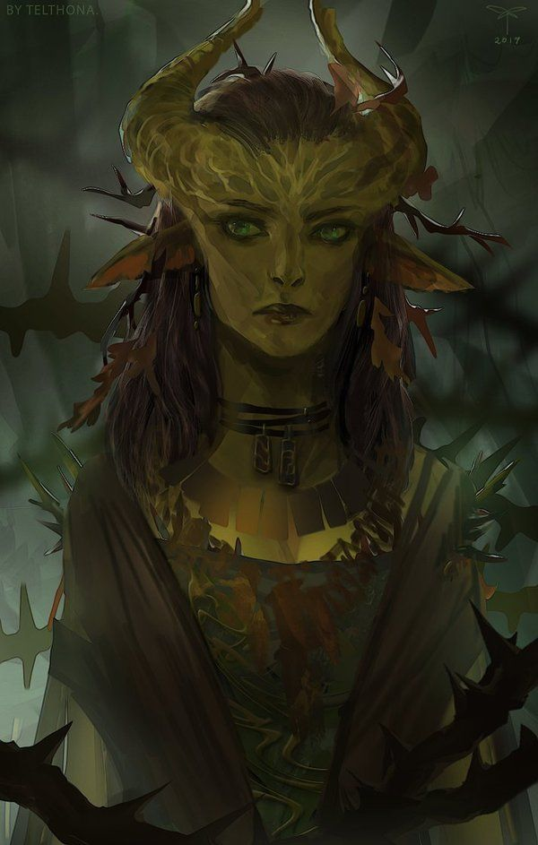
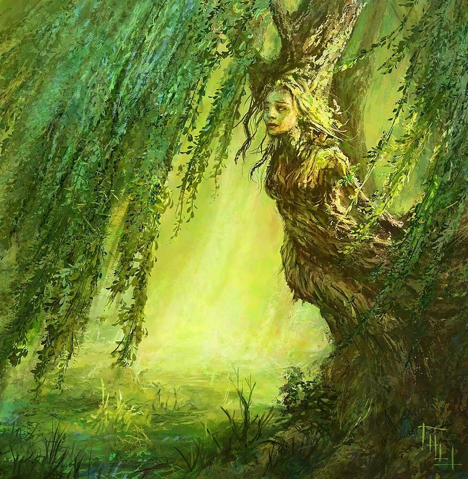
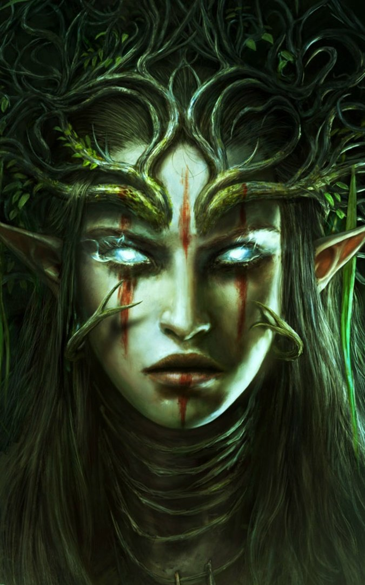
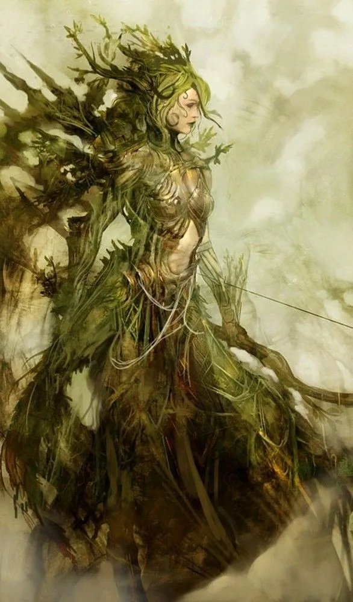
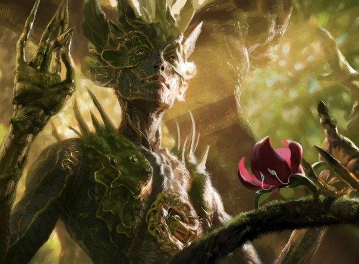

title: Дриады
parent: rasy
order: 160
icon: bi-person
image: photo/vk/533473434_457251165.jpg
layout: race
art: photo/race/driady-card.jpg
art_position: center 15%
group: Другие расы
vk: 54761832

## Общее описание

Дриады считаются многими учёными чем-то вроде природного явления, непременно появляющегося в массивно наполненных магией реках, обязательно лесных. Никто не может уловить эту закономерность. Во что же верят сами девы леса? Они истово верят в то, что каждая дриада рождается с обломанных ветвей богини Фариды, которые разбросаны по всей планете, и когда приходит время, магия пробуждает эти ветви, из них вырастают деревья — из деревьев — дриада, для того чтобы защитить леса и реки, полные тайн и секретов магии.

## Названия

Дриады, лесные нимфы, сильвы.

## Внешность, строение и особенности

Дриады не поддаются смерти из-за старения, и в этом плане существа практически бессмертные. Неизвестно ни одного случая смерти дриады из-за старости, очень часто перетекает это в совсем другие процессы, выбираемые во многом самой дриадой. Они всегда хрупки на вид, часто невысоки ростом, но в них скрывается сила, которая намного выше человеческой. Прошедшая перерождение из юной девы, дриада напитывается такой силой, что оказывается способна голыми руками расправиться даже с орком. Собственно, в перерождениях телесных оболочек и кроется вся уникальность дриад, а также их разнообразие, из-за чего с каждым десятком лет они всё больше перестают быть похожими друг на друга.
Дриады весьма плохо переносят в большом количестве алкоголь, который при неосторожности и вовсе может привести к их весьма мучительной гибели, подобно яду.
Первая ступень развития дриады — самое её появление на свет. Процесс рождения дриад весьма необычен: самые массивные деревья, питающиеся водами рек и озёр, сильнее всего пропитанных магией, и порождают дриад. Это весьма долгий процесс, который ни в коем случае нельзя нарушать, это чревато как гибелью самой дриады, так и дерева. С этого момента дриада и устанавливает связь с личным древом и лесом.

Молодые дриады наиболее приближены к людям или эльфам, как внешне, так и физически. Они обладают нежной кожей от зелёных и бежевых, до синих цветов. Очень редко на этой стадии развития имеются различные отростки по типу рогов, или иных вещей. Все дриады с рождения владеют магией жизни и дерева. В таком возрасте они зачастую очень любознательны и, несмотря на внешность, больше напоминают ребёнка. На взгляд многих рас практически все молодые дриады симпатичны внешне. Они ещё имеют подобие крови, тело пока что уязвимо для ранений и не столь крепкое. Редко, но всё же порой в таком возрасте дриады покидают места, к которым привязаны. Для семьи, где они родились, они становятся изгоями. Не проходит бесследно и разрушение связи со своим местом, где проходят перерождения и смены этапов жизни: часто дриады становятся всё более похожи на людей или эльфов, но начинают появляться различные мутации по типу частичного покрытия тела чем-то, напоминающим древесину, отростки ветвей прямо из тела, и прочее. Несмотря на разрыв связи, такие дриады всё ещё способны пройти смену оболочки с возрастом в любом другом водоёме, с ещё большим избытком наполненным магией.

Эта юность длится у дриад около 60-ти лет. Их тело со временем начинает изменяться, подготавливаться к ещё большим изменениям. Они становятся сильнее физически, кожа из нежной становится более грубой, начинает напоминать древесную кору, или очень жёсткий лист растения. После этого настаёт момент перехода в зрелую, основную стадию. Он происходит под воздействием магических вод. Тело дриады претерпевает весьма сильные изменения, во многом индивидуальные для каждой. Появляются различные отростки, часто напоминающие ветви, на которых даже растут листья. Иногда могут появляться подобия очень массивных и крепких рогов. Кожа же становится всё более грубой, иногда полностью покрывается древесиной. Также исчезают и многие физические потребности типа пищи. Кровь становится больше похожа на очень тягучий и густой сок растения. Возрастают и физические параметры, до такой степени, что без использования оружия дева становится способна справиться с орком, или несколькими крепкими человеческими мужчинами. Естественно, вместе с этим растёт и физическое сопротивление чему-либо. Например, части тела, полностью покрытые древесным слоем, могут даже остановить стрелу, или вовсе отрикошетить её. Многие дриады остаются именно в этой стадии по собственному желанию, но некоторые переходят на стадию, когда могут называться Матриархами.

Матриархи — дриады, переступившие черту в более чем 300 лет. В своём состоянии они полностью приобретают контроль над собственным изменившимся телом, благодаря чему способны к размножению. Матриарх может воспроизводить ростки на собственном теле, которые способны быстрее обычного вырасти в древо, которое породит уже другую дриаду. Внешне же эти дриады уже совсем далеко уходят от чего-то человекоподобного. Они напоминают ожившие деревья, тело которых полностью покрыто мощным древесным слоем, и является буквально почвой для роста цветков и иных растений. Они становятся максимально опасны для кого-либо, превосходя физически очень большую часть существ из других рас. Редко в таком возрасте дриады покидают свою семью, полностью являясь частью общества, где существуют. Растёт и магическая сила этих дриад, особенно врождённая магия дерева и жизни.

## Культура, типичное поведение, положение среди остальных и места обитания

Как уже было сказано, дриады появляются в любом случае у лесных рек и озёр, сильно переполненных магией. И таких мест на всей планете весьма много, поэтому можно считать, что дриады существуют повсеместно. Дриады вне своих лесов — редкость, а также почти всегда изгои по собственному желанию.
Во главе каждого общества дриад находятся одна или несколько Матриархов, которые определяют жизнь всей семьи. Дриады очень социальны друг с другом, настолько, что способны просто ощущать нахождение рядом другой дриады. Между ними столь сильная связь, что почти всегда друг с другом общаются они телепатически. Изучение языков при этом для них не является чем-то сложным, например, многие дриады Бранна знают как эльфийский, так и всеобщий. Нужен же он им во многом лишь для того, чтобы громко и эффективно прогонять всех со своих территорий словами. Дриады-изгои, что теряют связь со своим местом рождения, также теряют и особенность в виде телепатии с другими дриадами, как и способность чувствовать их. Когда таким пытаются что-то передать без слов, в голове наступает лишь весьма болезненный шум.
Среди дриад внутри семьи также нет особого понимания любви, как у других рас. Любят они друг друга как членов семьи, а личная привязанность к кому-то отдельному бывает лишь у молодых дриад, что редко перерастает во что-то после. Особого почитания удостаиваются Матриархи, способные давать жизнь другим дриадам. Их слушает каждая дриада, воспротивиться слову Матриарха — весьма осуждаемое действие. К чужакам же дриады относятся так, как велит Матриарх. Если в одном из лесов человека могут прогнать предупреждениями, то в другом он может без слов быть растерзан корнями деревьев или животными. Боятся же дриад в любом из случаев, ведь договориться как-либо с ними попросту невозможно. Несколько иное отношение у изгоев, которым попросту незачем испытывать агрессию к иным расам. Дружественно относятся дриады к элафакам и кентаврам, с первыми во многом даже дружат, из-за чего элафаков часто видят с дриадами.
Лесные девы являются основными жрицами богини Фариды, которая является для них самым важным божеством. В её честь у дриад есть достаточно праздников, молитв и прочего. Возведением храмов или чего-то подобного они при этом чаще не занимаются.
Есть и типичные предрассудки к дриадам, связанные с их этапами жизни, которые обычно являются правдой. Молодые дриады энергичны, любознательны, любвеобильны и при этом воинственные. Зрелые дриады уже более рассудительны, всё так же воинственны и во многом становятся чуток безразличны к остальному. Нередко в этом возрасте они становятся буквально помешаны на природе и превращаются в забавных чудачек даже среди других дриад. В таком состоянии дриада больше времени проводит с животными или растениями, часто желая уединиться. К возрасту, когда дриада готова стать Матриархом, она уже зачастую отдаёт себя семье, занимаясь проблемами хозяйства и иными вопросами в своём обществе.
