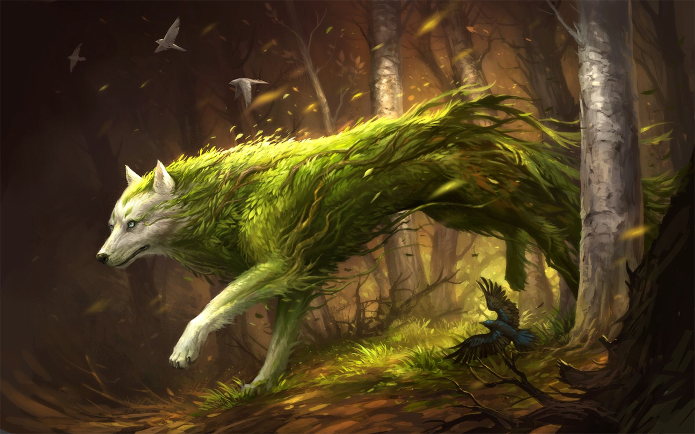

title: Элафаки
parent: rasy
order: 170
icon: bi-person
image: photo/vk/533473434_457251166.jpg
layout: race
art: photo/race/elafaki-card.jpg
art_position: center 30%
group: Другие расы
vk: 54761834

## Общее описание

Элафаки — разновидность духов природы и близкие родственники нимф. Многие в них даже не верят, так как они намного более редкое явление, чем рождение семьи дриад. Те, кто верит, считают их проявлением Кайяса, как раз ведающего преобразованиями в жизненных циклах.

## Названия

Элафаки, духи.

## Внешность, строение и особенности

Элафаки имеют духов-покровителей, а если быть вернее — оболочку. От духа-покровителя зависит всё будущее внутреннее и внешнее: элафак берёт облик животного-духа, черты темперамента и характера. Часто элафаки имеют животные повадки, наличие которых опять-таки зависит от духа, а количество уже от самого элафака. Физические параметры также зависят от духа-покровителя, что лежит в основе элафака. Рождаются эти существа глубоко в лесах, когда кто-либо погибает в лесу. Тело прошлого владельца очень сильно преобразуется духом-покровителем, который себе его находит, после чего появляется практически другое существо. До этого элафак может быть кем угодно: разбойником, знатным дворянином и так далее, но он уже никаким образом не может вспомнить ту жизнь, так как по сути это не его жизнь вовсе, ведь он как дух использует лишь чужую оболочку, преобразуя её под себя. Изначальным телом для духа не могут быть: орки, вампиры, оборотни и гномы. Встречаются они ну очень редко, многие в них даже практически не верят, считая их за красивую сказку, из-за чего известно о них также очень мало, ведь у них даже нет собственного народа, семей или чего-либо подобного — элафак полностью предоставлен сам себе.
Они обладают уникальной особенностью призывать своего духа-покровителя. Он питает их магические силы, позволяя элафаку не тратить собственную ману. Существует, однако, такой дух не дольше минуты. Взывать к нему они также могут не более раза в пару дней. Он тратит очень много энергии, и долгое использование грозит потерей духом найденного тела.
Сами между собой они даже не могут размножаться, из-за чего появление элафака — чистая случайность и стечение обстоятельств. Память прошлого владельца тела они могут уловить редко, как и какие-либо знания.

## Культура, типичное поведение, положение среди остальных и места обитания

Как говорилось, у элафаков нет даже собственных маленьких семей. Это сугубо предоставленные сами себе существа, действующие из своих побуждений. Мало кто боится их, многие в них вообще не верят или даже не знают о том, что подобные вообще существуют. Одни из тех, кто относится к элафакам очень положительно — дриады. Нимфы считают этих существ неотъемлемой частью леса. Им позволяется даже сосуществовать в семьях с дриадами. Эльфы в лесах Бранна замечали даже помощь элафаков дриадам.
Черты характера и прочее также зависят только от духа. И они могут быть совершенно разными, от небывалой жадности и корыстности, до слепой доброты. Изучение языков, письма даётся им очень просто, при желании. В остальном каждый из них уникален даже больше, чем насекомоподобные, из-за чего как-то объединять под единые стереотипы их нельзя.
