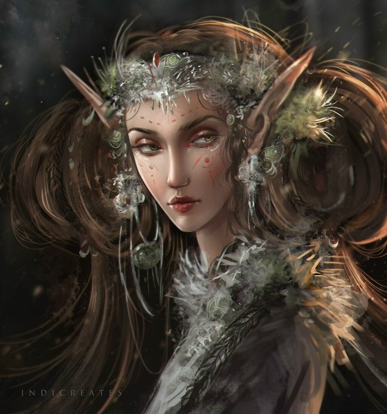

title: Эльфы Бранна
parent: rasy
order: 40
icon: bi-person
image: photo/vk/533473434_457251153.jpg
layout: race
art: photo/race/elfy-branna-card.jpg
art_position: center 25%
group: Эльфы
vk: 55340432

## Названия

Эльфы Бранна, альянса.

## Внешность, строение и особенности

У трёх основных видов эльфов есть общие отличительные особенности, среди которых чуть большая максимальная продолжительность жизни в сравнении с человеком, составляющая около 200-300 лет. С этим же связано то, что от природы их намного меньше, чем людей. Эльфы предпочитают не заводить ребёнка, если не смогут его обеспечить, или если не будут уверены, что их пара не распадётся.
Живут в среднем от 42 до 55 лет _(с учётом всех факторов типа детской смертности)_. Эльф, выросший до самостоятельного возраста, живёт в среднем 115-180 лет. Максимальный возраст жизни 200-300 лет.
Главная их отличительная черта — острые уши, являющиеся и главным предметом шуток и прозвищ. У разных подвидов эльфов они разные. И раз зашла речь о подвидах, то стоит выделить, что всего их 3: эльфы Бранна, эльфы Алькара и натаирские эльфы. Все три этих подвида образуют и соответствующие государства.
Эльфы Бранна — одни из первых, кто существовал на этом материке. Живущие в лесах, пропитанных магией, они и сами являются отличными носителями этого дара, маги среди них не редкость. Эти лесные жители всем запомнились благородными, что подчёркивается всей внешностью. Они высоки, от 190 до 220 см в среднем. Их кожа очень светлых тонов и даже не поддаётся загару. Хорошо с ней смотрятся и их в основном светлых тонов волосы, зелёные или голубые глаза. Это типичный портрет эльфа, что живёт в лесу Бранна.
Не отличающиеся большой силой, эльфы очень ловкие и гибкие. И последнее действительно поражает, так как эльф может делать со своим телом такое, что человек просто-напросто сломался бы. Поэтому танцам эльфы Бранна уделяют в культуре большое внимание, они красивые и сложные.

## Культура, типичное поведение, положение среди остальных и места обитания

В Бранне исконные эльфы часто существуют лишь в своих лесах на западе, никого туда не впуская, тем самым изолировавшись от остального материка. Однако им самим находиться в людских городах Корваса или ящеров никто не запрещает. Правда, в первых их крайне недолюбливают. В людских городах им приходится сталкиваться с расизмом в свою сторону и агрессией, что связано с их отношением к людям в их лесах. Также из-за этого попавшие в города людей эльфы нередко становятся козлами отпущения в каких-либо преступлениях, с которыми они даже могут быть и не связаны. Поэтому они и редко живут вне лесов.
В своих же лесах они, как уже было сказано, терпеть большую часть иных рас не намерены. Отсюда же у эльфов Бранна прирождённая неприязнь к кровным врагам — дриадам. Лесные нимфы — единственные, кто составляет им конкуренцию на единоличное владение лесами.
Во многом из-за их политики эльфы Бранна и кажутся всем высокомерными, не терпящими кого-то, не похожего на себя. Такие нотки холодности и высокомерия и правда часто прослеживаются у богатых и знатных эльфов. Обычные же крестьяне, или те, кто состоит в армии — скорее озлобленные. Внушение воспитанием ненависти к остальным такими их и делает, и мало кто этой пропаганде с самого детства не подвергается. Хотя люди всё равно путают озлобленность и высокомерие.
К культуре эльфы относятся трепетно. Они набожны, имеют много достаточно суровых традиций, устоявшихся во всём обществе. Очень большое влияние на культуру оказывали вера и драконы в очень древние времена. От последних эльфы Бранна по сей день используют язык и множество знаний. Даже архитектура связана с ними, о чём говорят многочисленные статуи. Также в архитектуре эльфы любят вычурность, создавать что-то сложное и необычное, чтобы это точно врезалось в память. Например, замок в Каэльморе. Такая же необычность обязательно существует в их храмах, посвящённых самым различным богам: от Эн`л до Лиаонос.
Особое место занимают музыка, танцы и прочее искусство. Талант к чему-то из этого высоко ценится среди них. Хороший музыкант или художник никогда не будет бедствовать, ведь иметь при себе таких любит знать.
Традиции же, как говорилось, местами суровы. Очень многое порицается обществом. Например, иметь ребёнка в неполной семье, не в замужней паре или без возможности его полностью обеспечить — дурной знак. Увидев такое, дитятко даже может забрать более обеспеченная семья. Это лишь повысит репутацию семьи, ведь все эльфы стремятся к тому, чтобы будущие поколения были лишь лучше и талантливее. А чтобы раскрывать талант, нужны условия и средства.
Также до 25 лет практически запрещены браки. Священники попросту могут отказаться женить такую пару, а их присутствие в этот момент обязательно. Хотя и сами эльфы до этого не особо спешат связать с кем-то свою жизнь, ведь партнёра выбирают один раз и навсегда. Связь с кем-то кроме эльфа в этом плане и вовсе может стать поводом для изгнания эльфа из лесов. Изгнание возможно и по другим связям или помощи чужакам, к этому относятся сурово. Смешение культур и размытие своей индивидуальности будет для них страшной трагедией.
