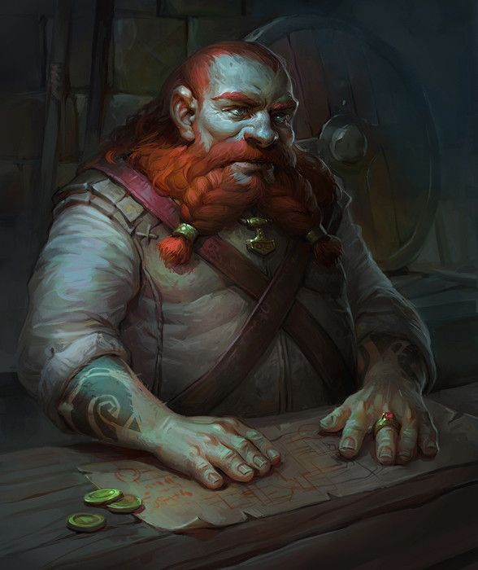
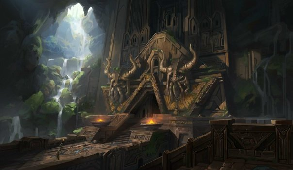

title: Гномы
parent: rasy
order: 80
icon: bi-person
image: photo/vk/533473434_457251157.jpg
layout: race
related: golm
related_title: Дополнительная информация
art: photo/race/gnomy-card.jpg
art_position: center top
group: Другие расы
vk: 54761820

## Общее описание

Одна из самых малочисленных, но самых древних рас. Это низкорослые мастера кузнечного дела, заядлые любители хорошей выпивки и просто отличные солдаты. Когда-то у них было больше двух государств, одно имелось и в Бранне, но полностью было стёрто людьми. Уцелевшие гномы в Бранне после этого не особо хорошо относятся к людям.

## Названия

Гномы.

## Внешность, строение и особенности

Гномы — низкорослые существа, в среднем ростом 150 см, как мужчины, так и женщины. Зачастую широки в плечах и обладают хорошей мускулатурой от природы. Также природа наделила их и хорошей сопротивляемостью к ядам и различным пищевым отравлениям. Собственно, эта же сопротивляемость организма работает и на пагубное действие алкоголя. Именно поэтому гномы делают самое крепкое пиво, обладающее крепостью порядка 90 градусов минимум! Человека можно будет уносить от одной кружки такого пива вперёд ногами, пока он пускает слюни, когда гномы будут опустошать бочонок. Гномы и сами-то не рады своей сопротивляемости именно в этом направлении. Максимальная продолжительность жизни гнома около 250 лет, при этом особо слабыми или обмякшими они не становятся до самой смерти.
Живут в среднем от 42 до 65 лет _(с учётом всех факторов типа детской смертности)_. Гном, выросший до самостоятельного возраста, живёт в среднем 105-180 лет. Максимальный возраст жизни 250 лет.
Также до смерти они никогда не лысеют от старости, у них не наблюдается привычных для многих проблем с памятью и прочего. Волосы у них в основном либо тёмных, либо ярко-рыжих, медных цветов. Однако в виде исключений бывают и светлые волосы. Глаза маленькие, глубоко посаженные и могут быть практически любых цветов.
К магии они не способны совсем, но также они и практически полностью неуязвимы к ней. Даже созданный магически поток пламени вряд ли причинит гному какой-либо вред. Откуда у них такая сопротивляемость ко всему созданному магически, неизвестно. Благодаря этому же они могут обращаться с некоторыми металлами типа Мифрила, Орихалка и Адамантита, что при обработке оказывают негативное магическое влияние до своей конечной формы. К тому же они почти всегда добывались лишь в Гольме, государстве гномов.
Физическая сила — ещё одно, что выделяет гномов, в том числе и как хороших кузнецов. В кузне они могут пробыть хоть целый день, спокойно переживая и высокие температуры, и скопления разных газов в воздухе. К тому же гному достаточно спать раз в 2-3 суток, энергии организма хватает надолго. Голыми ударами гном может сломать человеку руку. Своей силой они уступают лишь оркам, высшим вампирам и прочим подобным. Ловкостью при этом они тоже не обделены, хотя всякая скрупулёзная работа с мелочами им даётся сложно.

## Культура, типичное поведение, положение среди остальных и места обитания

Гномы не особо часто встречаются. Некоторые семьи остались ещё в Бранне даже после геноцида их государства, в основном же они живут в Гольме, не любя куда-либо высовываться. Гномы любят стабильность и спокойствие. Поэтому в постоянно нервной обстановке у них часто развивается излишняя раздражительность.
В культуре имеют место вероисповедания, например вера в Турна, но даже большее место занимают Предки. Предки не в том понятии, к которому многие привыкли. Предки — лишь те гномы, что очень сильно повлияли на развитие их общества. Стать Предком — одна из высших целей любого гнома. Во многом потому, что семьи Предков начинают получать власть, главы их домов входят в совет, выбирают короля и прочее. Всего у гномов сейчас есть 7 предков, и, соответственно, 7 влиятельных семей в Гольме.
Гномы очень трудолюбивы, если любят своё дело. Поэтому делать что-то из-под палки они очень не любят. Помимо этого, они хорошо следят за собой. Уважающий себя гном должен не только работать не покладая рук, но и следить за собой. Ухоженная борода, бани после работы, перебивание чем-либо запаха после попойки — обязательные дела!
Гномы не любят показывать свои слабости, и тем более не любят, когда на них указывают. Собственная честь для них вещь важная, и пятнать они её не позволят.
Хоть гномам везде и главное лишь практичность, скудной архитектура от этого не становится. Конечно, в первую очередь она выделяется своей монолитностью и каменной мощью. Их стены всегда кажутся абсолютно неприступными, дома построенными на века. Однако стоит просто присмотреться, чтобы увидеть аккуратно вплетённые во всё это образы Предков, множество красивых рун и орнамента поверх каменного монолита. Просто, но красиво — вот как можно это описать.

При этом обживаются они как под землёй, так и над ней. Под землёй живут в основном те, кто занимаются какими-либо производствами, кузнечным делом, например, или добычей руды. Также под землёй можно и вполне себе охотиться на различных существ, соседей гномов. Над землёй же процветают торговцы, часто связанные с кузнецами, чьи изделия они и продают. Да, кузнецы сами редко любят с кем-то говорить, разве что обговаривать индивидуальные заказы. Также снаружи гномы промышляют охотой, лесоповалом и, главное, защитой. Чтобы штурмовать подземный город гномов, нужно сначала хотя бы справиться с защитой снаружи. А это ой как непросто.

