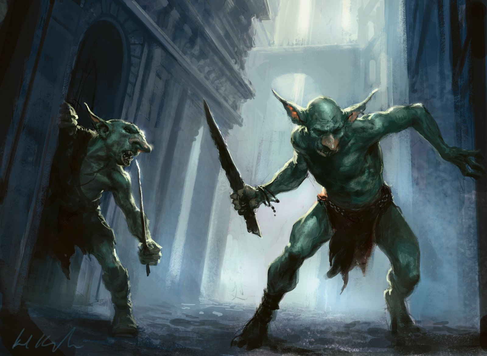
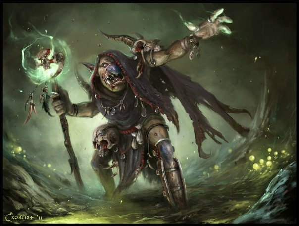
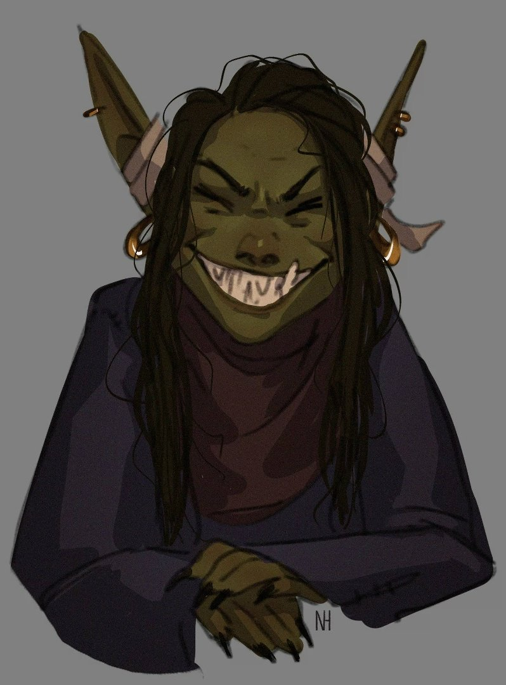

title: Гоблины
parent: rasy
order: 130
icon: bi-person
image: photo/vk/533473434_457251162.jpg
layout: race
art: photo/race/gobliny-card.jpg
art_position: center top
group: Другие расы
vk: 55239286

## Общее описание

Редковато, но повсеместно встречающиеся создания. О происхождении гоблинов известно мало, мало какие расы Наира являются им родственными, хоть и схожи они сразу со многими. По подобию гоблинов люди создавали первых орков, которые теперь и похожи на гоблина, только в разы более крупного. Долгое время гоблинов не считали за расу, относя больше к особо разумным зверям. Но с ростом государств и городов эти создания стали отлично адаптироваться к меняющимся условиям, ловко проникая в самые разнообразные ниши общества. И всё же много где это не самые желанные гости ввиду закрепившейся за ними гнилой репутации. Часто гоблины — постоянные участники банд, разбойничьих шаек, воры и подонки, которые мало кого жалеют. Но это лишь в большинстве своём.

## Названия

Гоблины — самое повсеместное, гоблы, смуук`ты (эльфы называют так гоблинов на своём языке).

## Внешность, строение и особенности

Гоблины не самые долгоживущие существа. Максимальный возраст, до которого может дожить гоблин, — это 40-50 лет.
Живут в среднем от 12 до 22 лет _(с учётом всех факторов типа детской смертности)_. Гоблин, выросший до самостоятельного возраста, живёт в среднем 25-40 лет. Максимальный возраст жизни 50 лет.
Более старшие гоблины — очень редкие случаи, особенно в консервативных племенах, где этот показатель ещё меньше. Зато развитие у них крайне быстрое, да и за раз рождается обычно больше одного гоблина. 2-3 ребёнка — это норма, при этом беременность занимает лишь 5-6 месяцев. За десяток лет гоблин крайне быстро растёт, легко приспосабливается к окружению и впитывает в себя от окружения всё именно в этот период. Из-за последнего у гоблина с течением жизни очень редко меняется характер, от воспитания в первый десяток лет в основном зависит вся дальнейшая жизнь. Уже к 15 годам каких-либо изменений в развитии гоблина не наблюдается, можно сказать, с этого момента он лишь начинает медленно стареть.
Магией владеют крайне редко. Те, кто могут её осваивать — в основном шаманы в племенах. И то их чародейства крайне скудные. Гоблин-чародей вне племени, способный тягаться в этом с человеком, — крайне большая редкость. Во многом это связано с особенностями их мозга и нелюбовью обучаться чему-либо.
Внешне гоблины мелкие существа, достигающие в среднем 125-130 см роста, гоблинши и того меньше на десяток-другой сантиметров. Очень редко имеют полноту, зачастую очень худощавы, могут утереть в этом любого эльфа. Кожа имеет цвета в основном зелёных, серых и синеватых оттенков. Она очень плотно прилегает к мышцам и костям, из-за чего её почти невозможно оттянуть. У молодых гоблинов она очень гладкая, к старости покрываясь множеством складок и морщин. К старости гоблины часто заболевают лишь характерной для них заразой, из-за которой на коже начинают пучками расти волосы, сама она шелушится, вдобавок ко всему начиная сильно вонять. При этом она не особо грубая и довольно уязвима к повреждениям, от чего спасает лишь очень хорошая регенерация. За пару часов на гоблине может затянуться множество царапин, от которых не останется даже упоминания. Эта регенерация способна вернуть гоблину даже полностью утраченный глаз, палец и даже часть мозга, если он был очень удачно и не смертельно повреждён! Правда, последнее не остаётся без последствий...
Особо выделяются уши и нос гоблина. Уши большие и острые, стремящиеся к макушке головы. Если к 15 годам гоблин перестаёт расти в целом, то его уши просто плевали на это ограничение. Они растут всю его жизнь, у всех с разной скоростью. Из-за этого они со временем начинают напоминать заворачивающиеся лопухи, которые начинают опускаться уже полностью вниз. Также это причина того, почему у многих это напоминает больше порванные паруса, а не уши.
Нос же довольно сильно выделяется среди всего лица, его кончик часто закручивается в крючок, и он довольно большой, хотя всё чаще встречаются гоблины с компактным носом.
Среди всего этого глаза тоже стоит отметить. Они совершенно разные у всех гоблинов. Могут быть мелкими бусинками, которые теряются на лице, а могут занимать большую его часть. Залиты они в основном жёлтым цветом с чёрным зрачком, но цвета могут сильно варьироваться.
Мускулистым телосложением не выделяются. Иногда гоблины могут хорошо развить у себя телосложение, но даже так максимум они могут потягаться при этом с человеком. Чаще они берут своё ловкостью и проворностью, вкупе с сильной живучестью и низким болевым порогом.
Гоблины обладают отличным метаболизмом. Есть они могут хоть помои, хоть вконец стухшее мясо. Вкусы различают они хуже людей, как и запахи. Гоблина часто можно даже не пытаться отравить. От очень сильного яда гоблин максимум просто выпадет на день из жизни, проблёвываясь где-нибудь тихонько, а на следующий день уже чувствует себя свежим. Человека столь сильный яд убил бы сразу. Есть им приходится чаще других, но не столь большими порциями. Зрение и слух у них несколько выше человеческих.
Волосы у гоблинов растут, но не у всех. Но если растут, то могут быть очень приличной длины, при этом цвета могут быть самые разные. Правда, о шелковистости и прочем можно забыть: это грубые и ломкие волосы, если не уделять им специального ухода. Именно поэтому гоблины любят удалять волосы подчистую.

## Культура, типичное поведение, положение среди остальных и места обитания

Гоблины встречаются везде, не только на материке Бранн. Они могут жить в самых разных условиях и хорошо себя чувствовать. Однако племена, которые сотнями лет жили лишь в одном месте, стагнируют в плане приспособленности к разным условиям, и даже резкая смена климата может стать для них катастрофой.
Собственной культурой обладают лишь гоблины, живущие в племенах. При этом у каждого племени собственные уклады, особенности жизни и прочее. Однако есть общие черты, вроде обязательного наличия вождя и шамана. Гоблинов, что живут вне племён, их деградирующие и консервативные собратья считают изгоями и никогда не впустят в племя, даже если те будут на грани смерти. Вождь — сильный, самый смелый среди остальных гоблинов. Если его и пытаются смести более трусливые участники племени — то только толпой. Вожди должны отличаться большей мозговитостью, ведь им нужно заботиться о целом племени. Помогают в этом, как понятно, шаманы, что часто берут на себя всякие масштабные хозяйственные дела, по типу разведения крыс на еду.

Веровать во что-то гоблинам не свойственно. В племенах могут быть максимум надуманные несуществующие божки, хотя чаще верят там вообще не в бога, а просто в огонь. Огонь делает что-то полезное, он больше достоин зваться богом! Исключения могут быть только среди гоблинов, не живущих в племенах. Особенно, если росли они в особенных условиях, предполагающих богослужение кому-либо. Так как гоблины впитывают в себя воспитание и прочее в первый десяток лет, дальше гоблин уже почти не может измениться, это большая редкость. Из-за этого племена и остаются консервативны. И из-за этого гоблин может вырасти кем угодно, в зависимости от того, где рос. Но жизнь такова, что с мелким гоблином вне племени никто возиться не будет. Если он чудом пережил период беспомощности, то дальше растёт уже сам. Такие гоблины часто и сбиваются в банды, или примыкают к другим бандам. Это самая частая судьба гоблина вне племени. Из-за этого за ними и закрепилась отвратная репутация среди всех. В городе завелась банда, убивающая и обворовывающая по ночам лавки? Скорее всего, гоблины...
В связи с этим, например, эльфы вообще не считают зазорным убивать гоблина на месте. Если найти гоблина в эльфийском городе, то можно сразу чётко понимать — он здесь незаконно, стоит показаться страже — труп. Ящеры тоже не особо жалуют гоблинов. В их столице гоблинов не увидеть, как и в Сердце Империи, но в иных городах они всё же встречаются.
Основное место обитания гоблинов вне племён — Империя людей. Люди могут плеваться, пинать почём зря шныряющего на улице гоблина, но им всё же не запрещают существовать в городах.
Гоблины не тупы, если росли там, где мозг был необходим, чтобы выжить. Да, они отстают ото всех по развитости ума, из-за чего нет гоблинов-учёных или очень хороших магов, но они вполне могут освоиться в торговле и прочем.
Свою внешность гоблины не оставляют без внимания. Любят размазаться краской, обмотаться бинтами, видя в этом особую эстетичность. А уши — идеальное место для бесконечного количества серёг. Однако такое внимание к внешности присуще в основном гоблинам вне племени. В племени особо извратиться для выделения могут разве что шаманы и вожди.

Особый пласт гоблинов — те, что полностью ушли к оркам. Эти ребята презираются как сородичами из племён, так и большинством вне их. В обмен на защиту здоровяков-орков они делают всё грязное в их поселениях, управляются со скотиной или в пивных. В Гром`Ха гоблинов встретить можно достаточно. И при этом они не принижаются орками. Они общаются с гоблинами на равных, ценя их занятость во всём, до чего оркам в племени дела нет.
Гоблины-изгои тоже очень часто остаются на прислуживании кому-либо, кто их растил. Ввиду воспитания в первые годы, хозяин может их хоть заплёвывать и унижать при всех, но они будут услужливо делать всё, что он скажет. Поэтому они не редкость в не самых хороших тавернах или корчмах.
