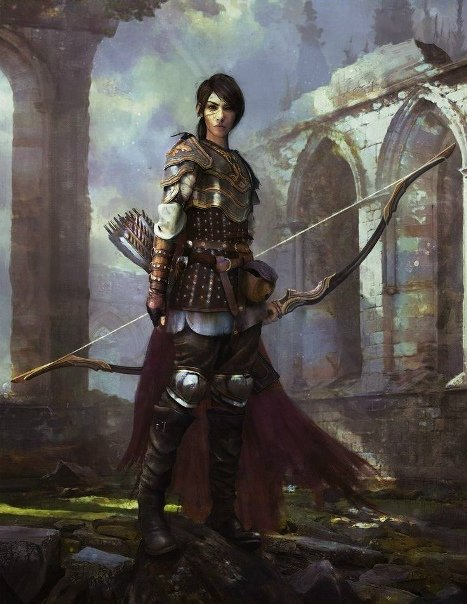

title: Граальды
parent: rasy
order: 10
icon: bi-person
image: photo/vk/533473434_457251150.jpg
layout: race
art: photo/race/graaldy-card.jpg
art_position: 16% 30%
group: Люди
vk: 55340430

## Общее описание

Граальды — самая многочисленная подраса людей. Их название идёт прямиком из страны, в которой их большинство и живёт — Граальдфад. Это одно из самых первых человеческих поселений на южных частях планеты. Именно они составляют большинство среди людей Бранна. В своё время Граальды расселились с места своего существования ещё задолго до создания своей страны, из-за чего и появились иные подрасы людей в самых разных частях планеты. Про те времена почти никто не помнит, какие-нибудь Сквоели и не поверят, что их предками были изнеженные временем и деньгами Граальды.

## Названия

Граальды, Граальдфальцы. Те, кого и именуют людьми, — они дают о расе основное представление.

## Внешность, строение и особенности

Граальды — самые усреднённые люди, формирующие о своей расе основное внешнее представление.
Живут в среднем от 22 до 35 лет _(с учётом всех факторов типа детской смертности)_. Граальд, выросший до самостоятельного возраста, живёт в среднем 65-80 лет. Максимальный возраст жизни 90 лет.
Наиболее активным временем развития является юношество, когда формируется человек в целом, здесь всё стандартно.
Граальдфальцы наиболее одарены магией среди других подрас. Самые известные чародеи, основатели магических школ в основном Граальды. Они способны овладеть любой из стихий магии, не имея предрасположенности к чему-то одному, что делает их в этом самыми универсальными, пусть и не самыми сильными.
Мужчины достигают в среднем 180 сантиметров роста, девушки чуть ниже — 165-170 сантиметров. Телосложение может быть самое разнообразное. Они имеют в этом плане некие предрасположенности, но вся прелесть в том, что они сами могут изменять себя образом жизни, тренировками. В отличие от них, те же эльфы при всём желании не смогут наесть бока или, наоборот, раскачать тело до горы мышц. И такая способность к преобразованию себя и всего вокруг у людей во всём.
У них светлая кожа, редко убегающая в смуглые или желтоватые оттенки. Аккуратные черты лица, небольшие глаза, в основном серых, голубых, коричневых и зелёных цветов. Разнообразием цветов хвастают и волосы, что могут быть как классически русыми, так и рыжими, или даже почти полностью белыми от рождения. У Граальдов самые уникальные черты лица среди всех. Даже среди родственников все друг от друга отличаются, хотя общее, конечно, всегда присутствует.

## Культура, типичное поведение, положение среди остальных и места обитания

Являясь самой многочисленной расой, Граальды встречаются чуть ли не везде, исключая самые суровые климатические зоны. Но всё же большая их часть находится в умеренных зонах, с чётко выраженными сезонами года. Самое крупное государство и очаг расселения людей — Граальдфад, находящийся к югу от материка Бранна. Люди Корваса, единственной Империи людей в Бранне, являются выходцами из Империи Граальдфада, и частично из других более мелких государств.
Давно поделённые на различные государства после расселения, они возводят собственные культуры в разных частях планеты, из-за чего и отличаются меж собой ею. Невозможно описать целиком культуру подрасы, которая расселилась почти по всей планете, начав создавать различные подкультуры. Однако у Граальдов есть, например, праздники, которые почитают лишь они. Большинство из них связаны с богами, в которых они верят. Например, день взывания к Эн`л, основному богу, в которого верит большинство Граальдов. В этот день люди отказываются от всяких услад жизни, будь то алкоголь, утехи или ещё что-либо. Каждый должен взмолить к Эн`л, чтобы тот не бросал своих созданий, продолжая одаривать их героями, которые остаются в истории Граальдов. Почти весь день стараются ничего не есть, основное празднование в своём привычном виде наступает лишь к ночи, ближе к переходу в следующий день. Тогда и даётся воля желудку, можно баловать себя винами и женщинами. Особо удачной будет считаться в такой день свадьба. Ещё одним примером праздника Граальдов, связанного с богами, является Праздник всех Праздников. Это день богини Асиры, которая покровительствует у них все праздники. В этот день ей преподносят фрукты, вина, исполняют специальные танцы и песни. Принято веселиться до самого утра следующего дня.
Как понятно, верят Граальды практически во всех богов, но самой основной является вера в Эн`л, их прародителя. Хоть в него также верят и иные представители рас, Граальды всё равно требуют от них особого уважения к Эн`л в своих государствах. Некоторые даже запрещают веровать в Эн`л, считая дозволенным это лишь для людей.
Граальды — самые разносторонние из всех людей. Характером каждый различен, все уникальны. Они могут подаваться в абсолютно различные сферы и достигать там успеха. В их способности приспосабливаться и лежит главная сила, благодаря которой Граальд не пропадёт нигде.
Однако даже так о них есть сложившиеся стереотипы, да и кое-что во многом лишь им и свойственно. Например, это одни из самых любопытных людей, которые готовы сунуть свой нос куда угодно, по самым разным причинам: желание обогатиться, получить новые знания или стать сильнее. Это и было толчком для их расселения в давние времена.
Являются они и воплощением человеческой жадности и эгоизма. Не найти более жадного человека, чем кого-то высокопоставленного из Граальдов. Политика и всё с ней связанное — тоже их удел среди всех остальных людей. А в политике особое место для хитрости, лжи и жадности.
Аристократизм среди людей также в основном ассоциируется в первую очередь с ними, что и неудивительно.
В остальном же разбирать культуру Граальдов правильнее по отдельным их государствам, чем рассматривать всех в целом. Ибо она очень разная и многогранная во всём, начиная от архитектуры и заканчивая одеждами.
Среди эльфов это самые ненавидимые люди. Многие иные расы также рассматривают их как захватчиков, например ящеролюди. Они заработали себе двойственную репутацию, сделав много хорошего и плохого. Но тёмные странички истории запоминаются всегда сильнее, чем светлые. Однако различные открытия людей в магии, технологиях и прочем всё равно высоко ценятся, не смотря ни на что. Самим же Граальдам расизм особенно сильно свойственен. Чего стоит грязная страница их истории, в которой мултиры долгое время были рабами. Или гонения и истребления рас, о которых из-за Граальдов теперь и не помнят.
