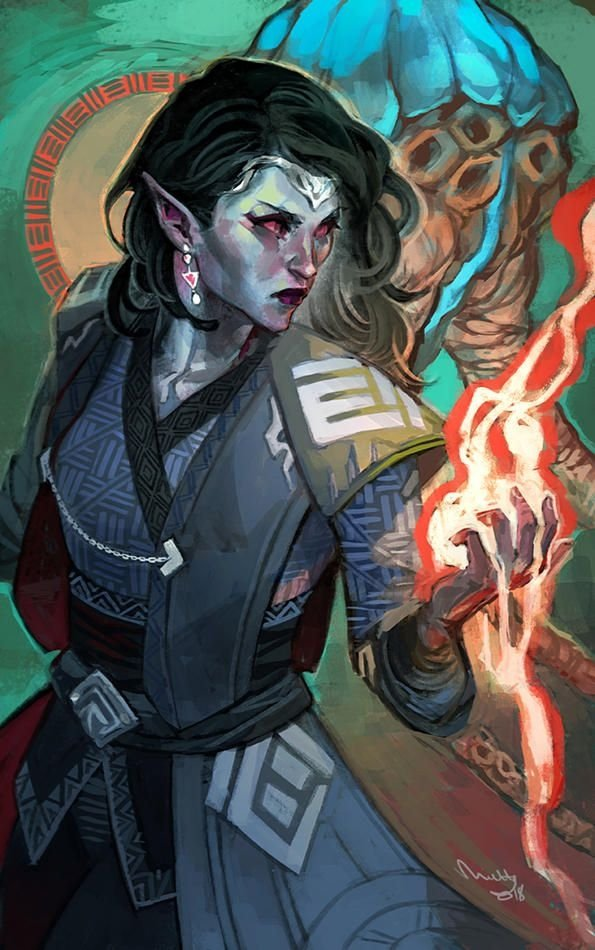
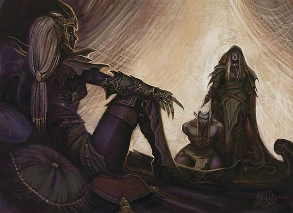

title: Хир
parent: rasy
order: 70
icon: bi-person
image: photo/vk/533473434_457251156.jpg
layout: race
art: photo/race/hir-card.jpg
art_position: center 40%
group: Эльфы
vk: 55348078

## Общее описание

Тёмные эльфы были созданы своим богом Хириком. Бог лжи создал народ под стать себе: хитрых, жестоких и властных. Своих детей он пометил тёмной кожей и назвал их Хир, потворствуя своему честолюбию. Эти эльфы жили в изоляции, потому миру ещё не довелось испытать всю силу их интриг и жажды подчинения.

## Названия

Тёмные эльфы, Хир, Народ Хир.

## Внешность, строение и особенности

Тёмные эльфы походят на что-то среднее между Алькарцами и эльфами Бранна. Максимальная продолжительность жизни Хир в среднем 180-200 лет.
Живут в среднем от 32 до 45 лет _(с учётом всех факторов типа детской смертности)_. Хир, выросший до самостоятельного возраста, живёт в среднем 85-110 лет. Максимальный возраст жизни 200 лет.
Их телосложение можно назвать статным. Им присущи изящные формы и внушительный рост до 190 см. Цвет кожи разнится от бледно-синего до тёмного серого. Волосы бывают от природы белыми, но наиболее распространены тёмные цвета. Также что мужчинам, что женщинам довольно просто вырастить длинные волосы на голове. Глаза преимущественно алые, фиолетовые и чёрные. С рождения физическая сила Хир посредственна, что компенсируется их адаптивностью и интеллектом.
Нередко оказываются наделены магической силой, причём маги они зачастую весьма сильные. Из-за особенностей состава крови мага легко отличить даже внешне: его глаза состоят из смешанных цветов алого и чёрного. Связана такая особенность с тем, что мелкие капилляры Хир не выдерживают потоков маны и лопаются. Это не сильно опасно из-за собственной хорошей регенерации тёмных эльфов, но постоянно доставляет некий дискомфорт. Также из-за этого Хир ограничены в использовании магии при своей возможной могущественности: сосуды тёмных эльфов не выдерживают напряжения и лопаются, что может привести к частичной временной слепоте, внутреннему кровоизлиянию и даже к смерти.

## Культура, типичное поведение, положение среди остальных и места обитания

Хир живут на небольшом острове в океане "Мёртвые воды". Это место стало коробкой игрушек жестокого бога, которого рьяно почитают тёмные эльфы. Государство построено вокруг веры, контроля и постоянной борьбы. Теология Хир разбита надвое: матриархат и патриархат. Каждая сторона включает в себя несколько домов, преследующих личные цели. В их мире власть и интриги решают всё, и дни будут блаженны, пока деяния угодны Хирику.
Король и его подчинённые ведут борьбу за господство над островом. Королева с желанием взирает на земли за морем, считая, что бесполезная возня за остров не стоит времени. После долгих лет изоляции Хир готовы показать миру, чего они достигли в искусствах обмана, иллюзий и яда.
Народ Хир долгое время жил в изоляции, формируя уникальную культуру. В основы своей обыденности тёмные эльфы закладывали ложь, интриги и жестокость. Хир открыто практикуют и поощряют рабовладение, всегда высокомерны по отношению к иным расам и рьяно ненавидят друг друга. Вся культура тёмных эльфов строилась и строится на бесконечной грызне меж двух теологий, из-за которой родному дому тёмных эльфов нет покоя на радость Хирику.
Впрочем, даже среди Хир нашлись отступники, отринувшие народ. Каждый из отщепенцев носит с собой проклятую монету, а главная их цель — освободить Ше`Ела от оков бога-лжеца.

_Авторы: [ソフィア ソフィア](https://vk.com/only_marmeladka), [Кирилл Кузнецов](https://vk.com/elvenarmavel)_
