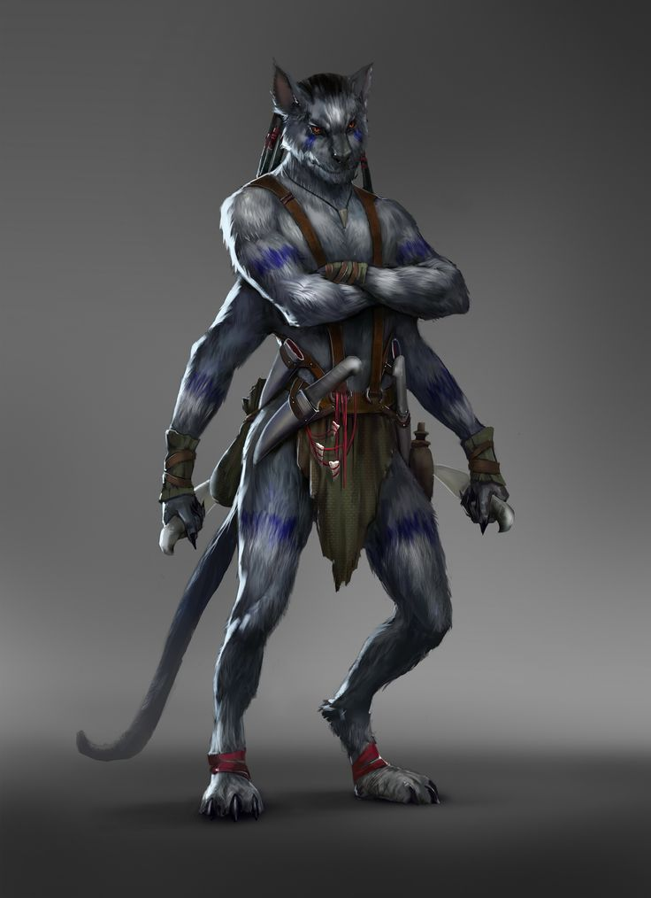
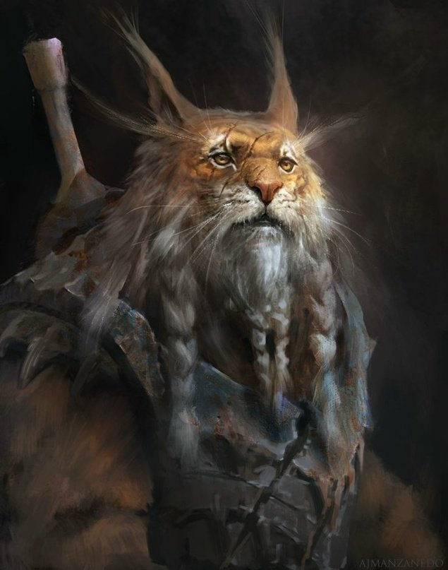

title: Мултиры
parent: rasy
order: 110
icon: bi-person
image: photo/vk/533473434_457251160.jpg
layout: race
art: photo/race/multiry-card.jpg
art_position: center 18%
group: Другие расы
vk: 54761827

## Общее описание

Мултиры — кошкоподобные существа, имеющие 1-2 пары рук и наделённые прекрасной силой. В Бранн они были завезены людьми, после того как они их нашли, обустраивая одну из колоний. Длительное время эти существа использовались как рабы из-за своих хороших физических показателей, пока рабовладение не отменили и не объявили незаконным. Немногие мултиры в Бранне перебрались в горы, создав там свой довольно крупный посёлок. Многие считают, что мултиры произошли от обычных диких кошек, коих было и есть очень много в их родных землях. Объясняя, как из кошки получилось что-то подобное, многие указывают на воздействие магии, вызвавшей мутации, вкупе с эволюционными действиями. Сами мултиры верят, что их создала богиня Эога.

## Названия

Мултиры.

## Внешность, строение и особенности

Как было сказано, мултиры похожи на антропоморфных кошек. У них малая максимальная продолжительность жизни, 50-55 лет максимум.
Живут в среднем от 18 до 25 лет _(с учётом всех факторов типа детской смертности)_. Мултир, выросший до самостоятельного возраста, живёт в среднем 35-50 лет. Максимальный возраст жизни 55 лет.
Почти всегда обладают очень крупным телосложением. Рост мултира в среднем 180-190 сантиметров. Они часто широки в плечах, лицо немного вытянуто. Глаза большие, обладают кошачьим зрачком, а также могут быть самых разнообразных цветов. Шерсть этих кошек чаще всего не особо густая, сильно вырастая лишь иногда на определённых участках типа головы. Она довольно грубая, напоминает щетину, и ухода особого за собой не требует. Цветов она бывает также абсолютно разных, от светлых, до синих или красных. Размножаются мултиры крайне плохо, что также связывают с магией, сильно повлиявшей на их развитие. С ней же связана и их главная особенность — порой мултиры рождаются с двумя парами рук. Такие кошки всегда вырастают наиболее мощными и сильными, чем в своё время и привлекли людей, у которых ещё было распространено рабство.
Как и у всех кошек, у них на высоком уровне зрение, слух и обоняние. Они даже могут чувствовать потоки маны и понимать, когда кто-то готовит заклинание. Сами же они, конечно, имеют потенциал к магии где-то на уровне человека. Ещё одной особенностью они унаследовали от кошек хорошее зрение в тёмное время суток. Оно хуже обычного дневного зрения, но не намного.

Уши иногда обладают кисточками, сильно выделяясь, как и длинные кошачьи усы. Последние не утратили полезности, они помогают собирать окружающую информацию и ощущать присутствие рядом себе подобных. Хвост мултира достигает 50-60 сантиметров, но бывают мутации, когда рождаются вообще без хвоста. Особых важных функций он не несёт, разве что до сих пор выдаёт эмоции хозяина непроизвольными движениями.
На ногах когти вырастают меньше, чем на руках. Некоторые состригают их, а некоторые используют как неплохое оружие. Незащищённую плоть они могут буквально вспарывать одним движением руки.

## Культура, типичное поведение, положение среди остальных и места обитания

Мултиры были завезены в Бранн с восточных степей и полупустынь, где и есть их родной дом. В Бранне же они перебрались к северу, где в горах создали относительно крупное поселение. Главными там являются сразу несколько семей, которые определяют жизнь поселения. К чужакам относятся спокойно, позволяя даже проживать в тавернах. Исключение разве что люди: по понятным причинам к ним они настроены агрессивно, порой брезгливо.
Сами мултиры немного безрассудные, не особо обращающие внимание на чужие законы. Они любопытны и любят делать то, что именно они хотят. Из-за этого за ними иногда следует дурная репутация хулиганов и нарушителей порядка. Сами по себе же они достаточно дружелюбны и открыты, порой даже слишком, весьма многое себе позволяя с едва знакомыми личностями. В такой простоте и открытости от различных устоявшихся норм многие находят их шарм. Между собой у них отношения тоже весьма необычны. Мултиры все знают друг друга и никогда не заводят пар надолго. В норме, когда мултир поживёт с одной, потом уйдёт к другой, а их дети будут бегать друг к другу, считая мамой что одну, что вторую женщину.
К знаниям, наукам и технологиям они тянутся не сказать, что охотно. Жизнь без особых изменений для них хороша и свободна. Не отличаются они и особой, привычной для всех набожностью. Они верят, что их создала Эога, но даже поклонение, не говоря о строительстве храмов, — редкость среди мултиров.
