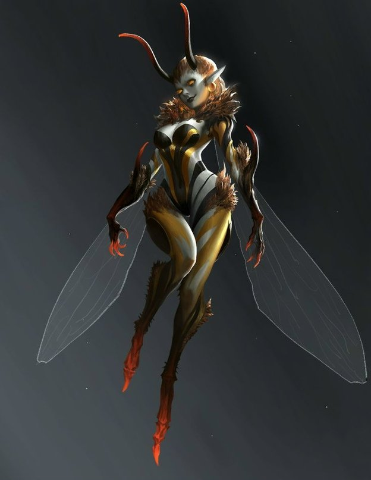

title: Насекомоподобные
parent: rasy
order: 150
icon: bi-person
image: photo/vk/533473434_457251164.jpg
layout: race
art: photo/race/nasekomopodobnye-card.jpg
art_position: center top
group: Другие расы
vk: 54761831

## Общее описание

Одна из самых необычных рас, которую даже трудно порой соединить под одной крышей. Каждое семейство уникально, как и они сами по себе, ведь часто появляются и единичные экземпляры кого-то из этих существ. Связано их появление с влиянием магии на насекомых в местах, очень сильно ею наполненных. Необычное существо может появиться из единичной куколки или личинки, пока все остальные их братья и сёстры так и останутся нишевой формой жизни. Или наоборот, подвергнуться неожиданному действию магии может целый выводок.

## Названия

Насекомоподобными мало кто их называет. Тут название уникально для каждого, ведь обозвать можно и мухой, и пчелой.

## Внешность, строение и особенности

Нельзя что-то сказать об общих габаритах или ещё чём-то в их отношении. Тут всё индивидуально, что и немудрено. Мутации от воздействия магии могут быть совершенно неожиданными, и потом даже может быть сложно понять, от кого уродился очередной насекомоподобный. Это может быть даже скопление кучи разных организмов, которые сплелись в один, настолько уникальными бывают случаи. Чаще они одарены магией с рождения, но бывают и исключения. Об общем потенциале расы к магии тоже говорить нельзя, даже как и о продолжительности жизни. Некоторые представители этой расы нежные существа, а кто-то может обладать мощным хитином и исполинскими размерами, способным без оружия уделать орка. Часто их хитиновые отростки могут имитировать оружие, не уступая ему по прочности и остроте, а порой усиленные собственным ядом или прячущиеся где-то в руках — они могут быть целым арсеналом, который станет неожиданностью для противника.

## Культура, типичное поведение, положение среди остальных и места обитания

Общего общества у насекомоподобных нет, да и распространены они по всему Наиру. Иногда выделяются некоторые из этих существ, которые живут семьями или даже орденами, как орден Веры. Некоторые же вообще могут признавать странными иные формы жизни, даже других насекомоподобных, быть себе на уме.
Очень многие их боятся. Причём в крупных городах к ним даже более терпимы, в то время как в деревнях нередко отправляют подобных на костры или вилы. Из-за этого некоторые предпочитают вовсе находиться в одиночестве.
