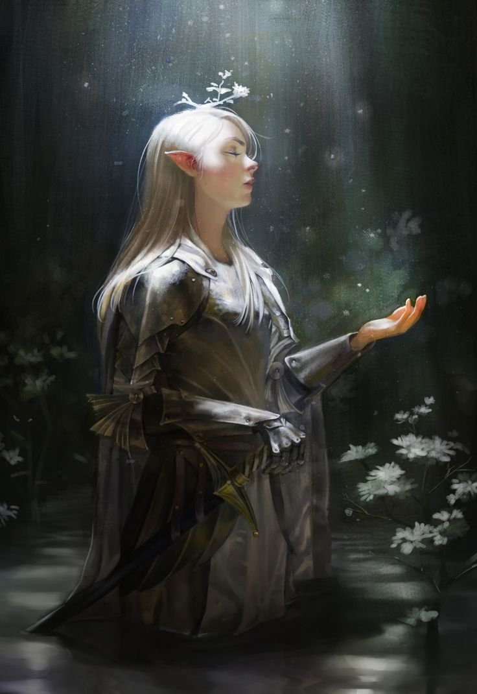

title: Натаирцы
parent: rasy
order: 60
icon: bi-person
image: photo/vk/533473434_457251155.jpg
layout: race
art: photo/race/nataircy-card.jpg
art_position: center 25%
group: Эльфы
vk: 55340434

## Общее описание

Самые причудливые и одновременно пугающие многих эльфы. Славящиеся армией и рыцарями, они вызывают у многих уважение. Известные отсутствием особой веры в кого-то из божеств и дикими традициями, совмещёнными с благородными целями, у многих они вызывают отвращение.

## Названия

Натаирцы.

## Внешность, строение и особенности

Среди всех эльфов эти физически наиболее совершенны, в чём могут утереть нос и людям, и ещё кому-нибудь. Они живут максимально около 200-250 лет, такие же среднежители, как и лесные эльфы в Бранне.
Живут в среднем от 52 до 65 лет _(с учётом всех факторов типа детской смертности)_. Натаирец, выросший до самостоятельного возраста, живёт в среднем 105-180 лет. Максимальный возраст жизни 250 лет.
Средний рост Натаирца около 180 см. Внешне они отличаются разнообразием в тонах кожи, цвете волос и глаз, чем во многом индивидуальны. Физически они могут достигать очень хороших результатов. Их организм может переносить большие нагрузки, долго обходиться без сна или пищи, а также отличается хорошей регенерацией травм. Вкупе с этим они всё так же способны к магии, немного отставая от эльфов Бранна. Отдельно стоит выделить их феноменальную память и внимание к самым различным мелочам. Хотя одновременно с этим они не особо многозадачны, в слишком стрессовых или торопливых ситуациях внимание уже слишком сильно рассеивается.

## Культура, типичное поведение, положение среди остальных и места обитания

Государство этих эльфов находится на самом южном материке Натаире, который скорее является особо большим островом. В связи с этим в Бранне они гости редкие. И путешествуют в одиночку они вообще редко, если только того не требуют высшие цели их походов.
Что касается высших целей, мужественность, честность и доброта — 3 столпа, на которые они опираются. С этими же столпами связано широко распространённое среди натаирцев рыцарство, чем они во многом и славятся. А также одной из сильнейших и боеспособнейших армий, достигших большого развития в военном деле. Ведомые своими целями, они совершили уже много успешных экспансий по устранению тех, кто не соответствовал их мировоззрению по трём столпам. На данный момент такими как раз являются Граальды, вернее их самое крупное государство к югу от Бранна. Они в активной войне с ними, ведь война этим эльфам нравится.
Вера на государственном уровне не сильно распространена, это личное дело каждого, главнее армия, сила, то, чем они и славятся.
Уже упоминались и диковатые при всех этих столпах традиции. Как пример, особое захоронение боевых товарищей. Каждый достаточно близкий к умершему должен съесть часть его плоти, это знак почитания, а также вера в то, что так они хранят сиу друг друга. Умершего хоронят только там, где он и погиб. Родственникам тела не возвращают, лишь извещения о гибели. Традиция есть плоть умерших не только в армии. Так делают и в семьях, веря, что так передаётся часть мудрости предков. При этом каким-либо болезням, связанным с каннибализмом, они не подвержены.
Зачастую их считают чудаками, немного побаиваются, так как такой эльф может без вреда себе даже закусить тобой. Последнее, конечно, просто пугалка для детей, хотя теоретически в случае поедания кого-то натаирцу действительно ничего не будет.
