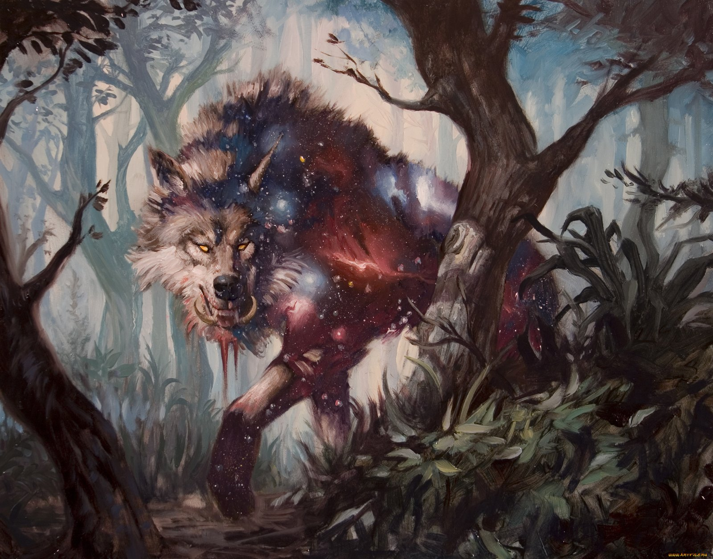
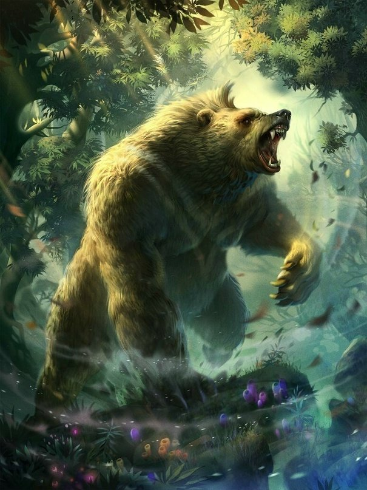

title: Оборотни
parent: rasy
order: 100
icon: bi-person
image: photo/vk/533473434_457251159.jpg
layout: race
art: photo/race/oborotni-card.jpg
art_position: center 30%
group: Другие расы
vk: 54761825

## Общее описание

Оборотни — относительно молодая раса с довольно загадочным происхождением. По преданиям, Мор одарил одних из первых людей даром оборачиваться в зверей, что было возможно даже их отпрыскам и будущим поколениям. Но другие люди боялись их, будучи зверьми они могли не контролировать себя, причиняли вред. Оборотням пришлось расселяться, уходить семьями или в одиночку в безлюдные места.

## Внешность, строение и особенности

Внешне оборотни полностью идентичны людям. Отличия очень малозаметны, по типу более грубой и плотной кожи или более жёстких волос. Также волосы растут у них намного быстрее. Физически в своей обычной форме они превосходят людей, более обострены различные чувства, по типу слуха и зрения. Живут максимально оборотни дольше людей, 200 лет в среднем.
Живут в среднем от 22 до 35 лет _(с учётом всех факторов типа детской смертности)_. Оборотень, выросший до самостоятельного возраста, живёт в среднем 105-130 лет. Максимальный возраст жизни 200 лет.
Их крайне немного, и на это есть много причин. Рождаются у оборотней дети только от оборотней, и только одно чадо. С самого детства у ребёнка начинается борьба с животной частью. Если с детства малыш не может контролировать переходы из животной формы в человеческую и наоборот, то он, скорее всего, погибает. Дело в том, что дар Мора терял свои силы, и стал для оборотней больше проклятием. Если долго находиться в зверином облике, более 3-х дней, назад вернуться уже сложно. Со временем и вовсе невозможно. Человеческое начинает угасать, в таком состоянии это уже не больше чем зверь, мучающийся с попытками человека взять контроль. Если другой оборотень видит такое, то принято избавить сородича от страданий. При этом оборотням обязательно нужно хотя бы раз в 5 дней принимать животную форму, иначе он может это сделать непроизвольно в любой момент, часто не самый удобный, при особенно сильных эмоциях.
У оборотней есть 2 основных животных формы, предопределённых с рождения. Медвежья и волчья. Обе формы не антропоморфны, оборотни просто похожи на намного более крупных животных, иногда с характерными индивидуальными особенностями, не свойственными этим животным. Превращение у оборотней происходит крайне быстро, не более 5-7 секунд. Это больше похоже на магическое обращение, а не привычное обрастание шерстью и так далее.
Оборотни не способны иметь магию, компенсируя это другими своими преимуществами. Одно из них — быстрая регенерация и общая живучесть, оба этих показателя особо велики в животной форме. Вести речь в животной форме может очень малое количество оборотней, но всё же это возможно. Но даже у последних, чем дольше они в форме животного, тем сильнее эта способность временно утрачивается.

## Культура, типичное поведение, положение среди остальных и места обитания

Оборотни в основном одиночные существа, сами себе выбирающие места для обитания. Реже встречаются семьи оборотней, которые существуют в основном как можно дальше от остальных. Определённых глав или старейшин в таких семьях в основном нет, это свободные образования, из которых оборотни спокойно выходят, и наоборот. Большинство относится к оборотням нейтрально, кроме людей. Последние весьма сильно боятся оборотней, что могут не контролировать себя. В некоторых городах оборотням открыто запрещено находиться, в том числе в большинстве городов Корваса. Сами оборотни тоже недолюбливают людей, да и вообще компанию и кого-либо, кроме их самих. И даже последнее многих тяготит.
Некоторые оборотни собираются не только в семьи, но и в группы шаманов. Это те из оборотней, кто всё ещё верит в Мора, считая его дар даром, а не проклятием. Они ещё более закрытые от всего мира, отстраивают небольшие храмы или святилища, не позволяя кому-либо, кроме оборотней, в них находиться. Слухи о них ходят не самые лучшие: от того, что они приносят кровавые жертвы, и до того, что держат чужаков в клетках, как животных. Что правда, а что ложь, даже сегодня неизвестно.
