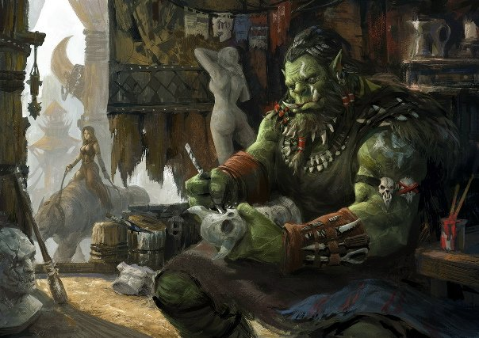
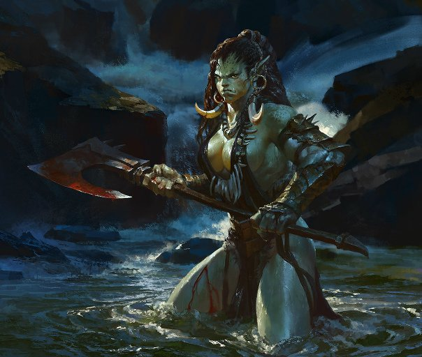
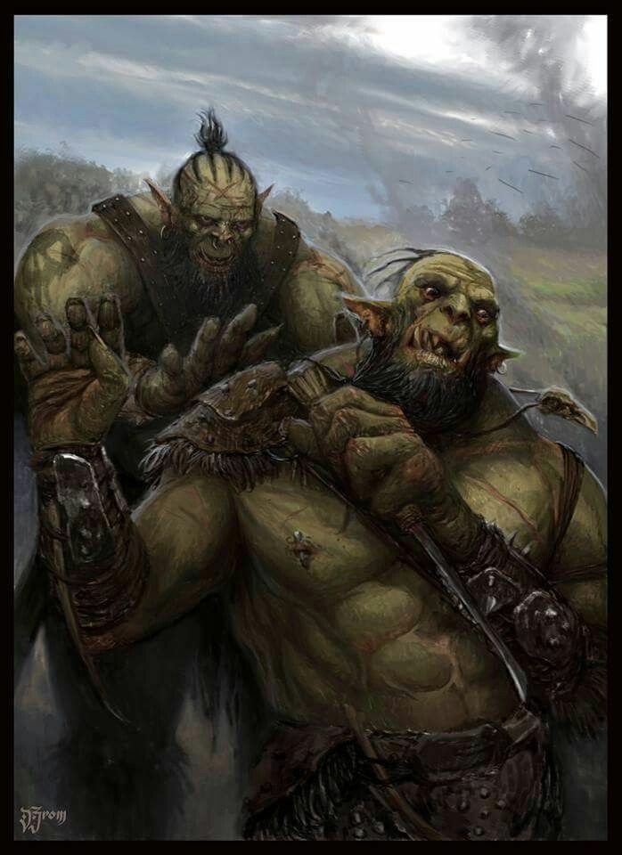

title: Орки
parent: rasy
order: 120
icon: bi-person
image: photo/vk/533473434_457251161.jpg
layout: race
art: photo/race/orki-card.jpg
art_position: 38% 28%
group: Другие расы
art_size: auto 155%
vk: 54761828

## Общее описание

Орки — магически созданные людьми существа ещё в Граальдфаде. Цель и замысел были весьма просты — очень мощная рабочая сила, с возможностью самостоятельного размножения и быстрого роста, чтобы не приходилось создавать новых орков, а просто контролировать популяцию. В Граальдфаде это работает до сих пор, а вот в Бранне случилось неприятное. Ещё во время перевоза орков на новый материк очень малая часть смогла сбежать. Когда же случился печальный раскол Громула, орки воспользовались суматохой, вырвавшись из плена.

## Названия

Орки. Некоторые люди не гнушаются называть их и големами, хотя во многом такое название будет неправильным.

## Внешность, строение и особенности

Орки, конечно, создавались не только сугубо с помощью магии. За основу были взяты человек и гоблин. Общее строение от первых, и желаемая приучаемость в раннем возрасте от вторых. Второе у первых орков вполне себе даже было, но с новыми поколениями быстро выветрилось. Магия же нужна была для скрепления всего этого и придания желаемой физической мощи. И получилось это хорошо. Средний рост орка — минимум 220 см при массе 180 кг, для мужчин. Женщины ростом около 200 см и весят в среднем 150 кг. Мускулистость и большие сила и выносливость закладываются в них с детства. С гоблинами они схожи очень быстрым ростом, после 13-15 лет орк уже перестаёт расти, достигая своих лучших форм. Живут орки при этом тоже не особо долго, около 60 лет максимум.
Живут в среднем от 32 до 45 лет _(с учётом всех факторов типа детской смертности)_. Орк, выросший до самостоятельного возраста, живёт в среднем 45-50 лет. Максимальный возраст жизни 60 лет.
Рождается у орков не более 1-2 детей за раз, при этом беременность дольше человеческой на пару месяцев. Зато дети растут быстро и всегда переживают своё юношество.
Кроме быстрого роста, от гоблинов перешли хорошая пищеварительная система, позволяющая есть почти что угодно без особых последствий, и очень сильная регенерация. Остальное же является больше случайно возникшими особенностями. Например, у орков отменное здоровье, иммунитет защищает практически от любых болезней, оставляя хозяина постоянно на ногах. Плюс магическая природа снижает вред от заклинаний, а от заклинаний разума или иных проклятий вовсе защищает полностью. При этом сами орки не обделены магией, но их потенциал очень низкий. Кожа орков очень грубая, хорошо защищает от различных нежелательных ран. Имеет при этом насыщенный зелёный цвет. Иногда бывают мутации, при которых кожа приобретает красноватые или бежевые оттенки, учитывая их природу это не особо удивительно.
Кровь, как и у гоблинов, зелёного цвета.
Черты лица немного грубые, среди которых выделяются массивные нос и зубы, часть которых часто перерастает в вечно торчащие мощные клыки. Зубы растут у орков всё время, в частности клыки. Некоторые подпиливают их, а некоторые позволяют свободно расти, пока те не начинают угрожающе торчать из мощной челюсти. Мелкие глаза теряются на лице под большой лобной долей, откидывающей на глаза тень, из-за чего их иногда и не разглядеть. Острые уши довольно большие и всегда торчат вверх, но до эльфийских или гоблинских им всё равно далеко.
Голову обычно покрывает весьма большое количество жёстких волос, преимущественно тёмных оттенков. Славятся орки и своей выносливостью и набираемой скоростью, мощные ноги этому способствуют. В целом они далеко не медлительные при своих габаритах, даже в меру ловкие. При охоте они могут просто догнать свою добычу, не пользуясь всякими луками.

## Культура, типичное поведение, положение среди остальных и места обитания

Основная часть орков всё ещё находится в Граальдфаде. В Бранне же основной клан и поселение орков — Гром'Ха. Это небольшое поселение на территории Корваса. Заправляет там всем вождь, глава, называть можно как угодно. В Гром'Ха существуют деления всех на определённые роли, чем занимаются специально отведённые для этого орки. Без дела не должен сидеть никто. Стоит упомянуть, что сосуществуют здесь с ними гоблины, что ищут защиты и дома, взамен занимаясь также различной работой, которую оркам сложно делать ввиду своих габаритов, или просто муторно. Отношение к ним не как к рабам или ещё кому-то подобному: бывшие раньше сами такими, орки относятся к гоблинам на равных. Чужаков здесь не жалуют, к каждому относятся с опаской и без веской причины и внутрь не пускают. Орки смогли плюс-минус нейтрально относиться и к людям Корваса, в котором отменяется рабство, в том числе направленное и на орков. Однако видеть их не желают всё равно больше всего.
Сами орки известны своей вспыльчивостью и любовью к прямолинейности с лёгкой грубостью. Они при этом легко понимают, когда их пытаются облапошить или ещё что-то в этом роде. К высоким наукам и подобному орки, конечно, не способны, но они вполне могут обучиться письму, чтению и даже выучить чужой язык. Говорят они, кстати, пока преимущественно на всеобщем, привычном для людей языке.
Тянутся орки и к самовыражению. Они любят раскрашивать себя красками. Что женщины, что мужчины любят носить серьги, желательно крупные, ожерелья и прочие украшения, часто из того, что подберётся под руку. Саму одежду жалуют не очень, порой обходясь вообще без неё, если этого не требует погода или ещё что-то. Даже вера у них есть, и это отдельный пункт. Во время их побега собой героически пожертвовал один из орков — Рогур, который большую часть всего и спланировал. Орки были столь благодарны ему, что сильная вера и память столь небольшого количества существ смогла внести его в один ряд с полубожествами. Теперь это знаковая фигура, имя которой знает каждый орк.
Гром'Ха, как говорилось, лишь одно из поселений, хоть и самое большое. Некоторая часть орков ещё сначала отбилась от основной массы, уйдя далеко в горы. Это уже настоящие варвары и идиоты. Очень малочисленные племена этих орков по большей части лишь стагнируют. У них нет особой культуры, кроме культуры силы. Они всё решают через неё. Завязать с ними разговор выйдет, если только вы другой орк.

Есть те, кто откололся и позже уже от Гром'Ха. Клан Топора, не ставший мириться с мягкотелой позицией терпимости орков даже к людям. Эти ребята хуже варваров: убивают без особых причин и, что самое главное, не глупы, как горные братья. Уже они поставили себе довольно несбыточную цель освободить и орков в Граальдфаде.
