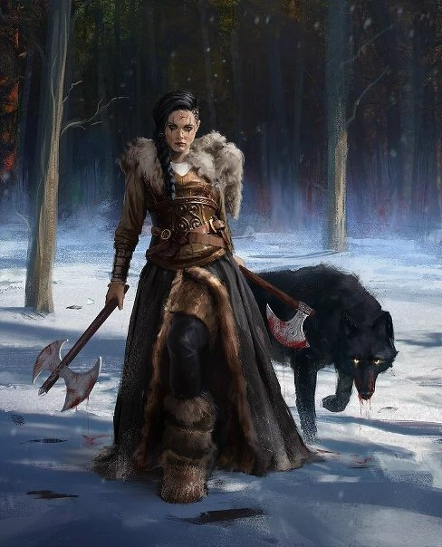

title: Сквоели
parent: rasy
order: 20
icon: bi-person
image: photo/vk/533473434_457251151.jpg
layout: race
art: photo/race/skvoeli-card.jpg
art_position: center 15%
group: Люди
vk: 55340431

## Общее описание

Главная гроза северных морей, бесстрашные островитяне. Эти люди, пожалуй, вызывают лишь страх. Сквоели обладают самой тёмной и пугающей репутацией, мало кто хочет случайно оказаться в деревушке в заснеженных горах или быть выброшенным на берега северных островов.

## Названия

Сквоели, островитяне.

## Внешность, строение и особенности

Ростом они похожи на граальдов, всё тот же средний человеческий размер. Однако телосложением отличаются, и довольно разительно. Хоть они тоже худощавы, через это пробивается хорошая, подтянутая форма. Их кожа более грубая, приспособленная к суровым холодным условиям. Волосы растут более активно, чем у всех иных людей, в том числе и борода у мужчин, которую они любят оставлять. Волосы также бывают разнообразных цветов, как и глаза, а вот кожа ещё более белая, чем у граальдов.
Живут в среднем от 22 до 25 лет _(с учётом всех факторов типа детской смертности)_. Сквоель, выросший до самостоятельного возраста, живёт в среднем 45-60 лет. Максимальный возраст жизни 90 лет.
В отличие от Торвеннов они хорошо переносят лишь мороз, в неожиданной жаре им может очень сильно поплохеть, выносить её Сквоель будет очень тяжело. Магией не обделены, немного отстают в этом от Граальдов, но её использование во многом считается признаком слабости, особенно в обычных дуэлях. Среди всех людей они обладают самой развитой выносливостью и самым высоким болевым порогом, что делает из них воина, не отвлекающегося на мелочи вроде ранений. Такой человек может не спать несколько суток и чувствовать себя всё ещё приемлемо, здраво мысля и действуя.

## Культура, типичное поведение, положение среди остальных и места обитания

Обитают Сквоели в основном на северных островах, достаточно далеко от Бранна. Редко их корабли можно видеть в водах поблизости. В самом же Бранне есть несколько мелких деревень, глубоко в заснеженных горах. Мало кто решается там оставаться, потому что места эти считаются гиблыми для обычных путников. И неспроста.
В глухих деревнях сквоелей, особенно отделённых от остальных существ, нередко процветают не самые радужные обычаи. Убийство стариков и слабых, мешающих выживанию, культы, в которых практикуется каннибализм, как способ взять себе частицу чужой силы. На островах, где крупные города и селения, такое, естественно, не приветствуется и всячески наказывается. Но о глухих деревнях такого не скажешь. Чужаков в таких местах не любят, по своей глупости можно стать частью животного ритуала и быть частично съеденным, находясь в сознании. Такие случаи известны, и таких людей ждала страшная месть за их деяния. Зайдя в подобную деревеньку, нередко можно почуять в воздухе и запах палёной плоти. О, это излюбленная вещь одичалых сквоелей, на которую они идут добровольно, чтобы показать свою выдержку и стойкость. Сильнейшие мужчины идут на это, чтобы доказать готовность к чему-либо, показать свою мощь или претендовать на звание старейшины деревни. Стандартное испытание, которое ни в коем случае не используется как наказание. Ведь выдержать прикосновения раскалённого железа может не каждый, а значит, это ли не лучшее проявление мужества?
Однако всё описанное выше касается лишь особо одичалых сквоелей. Островитяне более радушны, однако заслужить их гостеприимство придётся. Силой, помощью им — неважно. Просто так любезничать с кем-то ни один сквоель не будет.
Особое место у них занимает мореходство. Сквоели — лучшие плотники, рыбаки и... пираты. Причём пиратство у них одобряется и законом. Набеги на тех, кто не согласен с их устоями, — вполне обычное дело. Они почти не ведут торговлю с кем-либо, однако глупых войн не развязывают.
Отличаются все сквоели и своей крайне низкой набожностью, чаще можно встретить сектантов, чем сквоелей, ставящих богов хоть во что-то. За это они во многом порицаются другими людьми. Что касается прочих рас, то они тоже скорее остерегаются сквоелей, чем как-либо уважают. Особо рады им будут мало где, а по отмороженности с ними могут конкурировать разве что гоблины.
