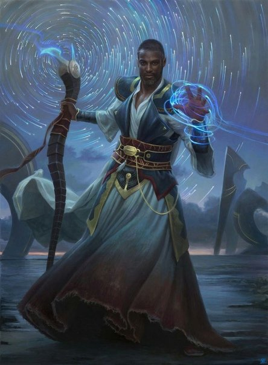
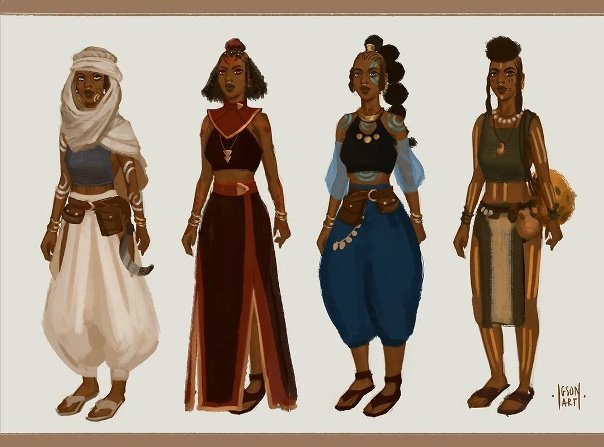

title: Торвенны
parent: rasy
order: 30
icon: bi-person
image: photo/vk/533473434_457251152.jpg
layout: race
art: photo/race/torvenny-card.jpg
art_position: center 35%
group: Люди
vk: 55340435

## Общее описание

Те, кто в древние времена расселений освоили самые жаркие пустыни планеты. Торвенны далеко не самая распространённая подраса людей, но сильнее всего отличаются от остальных почти во всём, чем и интересны. И при этом это всё те же люди.

## Названия

Торвенны — общее название среди всех остальных людей. Эльфы благородно называют их детьми пустыни.

## Внешность, строение и особенности

Торвенны — наиболее развитые физически люди. Среди них могут быть настоящие гиганты, рост более 200 см встречается весьма часто, даже среди женщин. От природы у них хорошая мускулатура и выносливость.
Живут в среднем от 22 до 30 лет _(с учётом всех факторов типа детской смертности)_. Торвенн, выросший до самостоятельного возраста, живёт в среднем 55-70 лет. Максимальный возраст жизни 90 лет.
Здоровьем они не обделены и отлично сопротивляются различным болезням или перепадам, будь то температура или давление. Естественно, они довольно легко переносят жару, могут долго себя вполне нормально чувствовать даже при 50 градусах плюсовой температуры. При этом и на холоде они не будут трястись, как листья деревьев на ветру.
Чтобы держать такое мощное тело в полном порядке, им необходимо достаточно плотно и часто питаться, желательно самой различной пищей, да и вкусы они различают получше аристократичных Граальдов. Алкоголь не особо ценят, ибо на их организм влияет он по-особому сильно, так что крепче лёгкого вина выпивают что-то очень редко.
Кожа имеет тёмные оттенки, от шоколадных до практически чёрных. Она более грубая и плотная, отлично защищает от случайных порезов или ушибов. Черты лица у них более грубоваты и квадратны, в отличие от других людей, и часто они схожи друг с другом. У Торвеннов более широкий и большой нос, глаза часто посажены довольно глубоко, ресницы пышные. Цвет глаз может быть коричневым, зелёным или серым. Голубые, жёлтые цвета встречаются очень редко. Волосы зачастую лишь чёрного цвета. Мужчины вообще предпочитают сбривать их. У женщин они часто волнистые и при этом не особо длинные.
Пустыни, в которых они проживают, менее всего наделены магией. Поэтому маги среди Торвеннов — редкость. И потенциал даже при наличии магии у них невелик. Наиболее ценятся в засушливых пустынях маги воды, и даже несмотря на меньшую предрасположенность к магии в целом, в водной стихии они почти лучшие.

## Культура, типичное поведение, положение среди остальных и места обитания

Торвенны обитают в пустынных частях планеты и очень редко встречаются в иных местах, в том числе и в Бранне. У них есть несколько крупных государств, которые не ведут каких-либо активных военных действий, сотрудничают друг с другом и с другими странами.
Вся культура Торвеннов построена на терпимости и любви друг к другу и к иным расам. Они не терпят лишнего кровопролития, чаще стараются искать мирные выходы из различных ситуаций. Поэтому славятся своими дипломатами, способными отлично воздействовать на иные власти. Честность, сострадание и честь — это основное, что должен уважать каждый Торвенн. Они ценят свободу, проявляется это даже в архитектуре и их стиле одежды.

Они славятся и своим гостеприимством, готовностью помочь даже незнакомцу. Однако последние обязательно должны почитать те же ценности, что и они. Терпеть насилие к слабым, высмеивание чести и прочие подобные низменности они не будут. Закон в пустынях столь же суров, сколь велико желание Торвеннов жить в мире. Воры и разбойники среди них — большая редкость. Для многих это столь низкий поступок, что со временем они скорее сами себя накажут, чем дождутся этого со стороны. Столь сложно этим людям наступить на горло ценностям своего народа.
Среди богов они также почитают Эн`л и некоторых других богов. Особое место в вере отводится Ше`Елу, Макемраид, Итишии и Палотариосу.
Среди других рас они также выглядят в довольно светлом ключе. Весьма хорошо к ним относятся даже эльфы Бранна, что многого стоит, учитывая их нетерпимость к Граальдам, всё тем же людям. Сами они также стараются видеть во всех что-то хорошее, сколь сильно бы он от них ни отличался.
