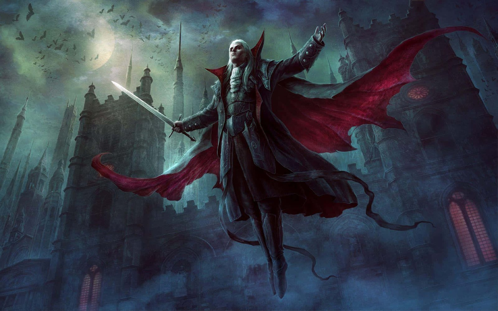
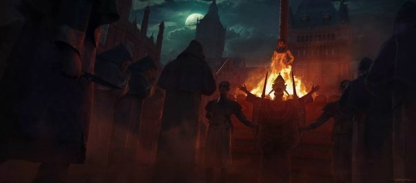

title: Вампиры
parent: rasy
order: 90
icon: bi-person
image: photo/vk/533473434_457251158.jpg
layout: race
art: photo/race/vampiry-card.jpg
art_position: center 25%
group: Другие расы
vk: 54761823

## Общее описание

Порождения ночи, постоянно ищущие источник крови, эти существа — сущий кошмар и большая проблема для любого. Никто так и не смог до сих пор понять, откуда взялись эти существа, из-за чего есть лишь догадки. Самая популярная из них гласит, что все вампиры, разумные и нет, произошли от одного первородного вампира, созданного Ховаром как его хранитель. Да, глэды, протоглэды и прочие не совсем разумные вампиры — родственники вершины этой ветви — разумных вампиров.

## Названия

Вампиры, ша`сэр ("ночной" с эльфийского).

## Внешность, строение и особенности

Вампиры имеют людскую и эльфийскую внешность, так как с ними удобно маскироваться среди всех, однако не стоит искать ничего общего между ними и этими расами. Это физически превосходящие многих существа, как бы они ни выглядели. Их кожа бледна и не наполнена жизнью, отдавая холодом при прикосновении. Медленно бьющееся сердце — часть причины этого, так как кровь разносится не столь уж быстро. Они неподвластны времени, всегда остаются внешне приятными самим себе, легко изменяя при необходимости что-то во внешности. Однако такой процесс мимикрии занимает время, кардинальная смена внешности займёт больше года. Челюсть имеет 2 острых клыка, необходимых лишь для создания раны, чтобы высасывать кровь. Высасывается же она уже языком, у которого есть несколько присосок. Эти существа опасны, и спасает лишь их малочисленность, ввиду того, что они способны размножаться лишь друг с другом, но у большей части вампирш отсутствует желание вынашивания ребёнка.
Вампиры имеют тягу к крови именно разумных существ, что является их основной пищей. 10 литров выпитой крови способны обеспечить существование без необходимости охоты на месяц. Необходимость пить кровь исчезает лишь у высших вампиров. Все остальные начинают буквально сходить с ума без длительного употребления крови. Постепенно в них начинает гаснуть разумность, они перестают отличаться от, например, глэдов. Только после употребления крови возвращается рассудок, часто с потерей памяти о прошедших днях. В ином же случае вампира ждёт мучительная смерть, что часто используется другими как пытка для пойманного вампира. Также вампиры ещё переносят болезни от одних жертв к другим, если им удаётся выжить, сами при этом практически ко всем болезням оставаясь неуязвимыми.
Смысл в большем потреблении крови есть при необходимости регенерации. С большим количеством крови вампир способен отрегенерировать конечности, не погибнуть от критического ранения органов и залечить их. Также вампиры имеют врождённый дар к магии крови и полный к ней иммунитет, как и к магии разума. Среди вампиров есть деление по рангам:

- Вампир;
- Носферату;
- Высший вампир;

_(В начале игрок не может быть выше ранга "вампир")_

Обычные вампиры — самые распространённые ночные кровопийцы. Они полностью уязвимы перед солнцем, выжигающим их кожу за минуты. Более того, даже просто днём оно имеет влияние и не при прямом попадании, из-за чего им сложнее пользоваться магией, запас маны сильно урезается, а её регенерация днём невозможна. Они слабее более высоких по рангу вампиров, их рефлексы на уровне человеческих. Только несколько более высокая сила позволяет им приспосабливаться во враждебно настроенном мире.
Носферату уже намного более серьёзный противник, способный противостоять множеству врагов. Высокая реакция, сила, близкая к орочьей,, и внушаемый другим вампирам страх. Даже обычные разумные вампиры невольно испытывают страх, так как это заложено в них. Глэды, или протоглэды, вовсе будут бежать от подобного вампира, а одного из них при должном усилии он может подчинить в качестве питомца. Но для них всё ещё остаются опасными выжигающее солнце и постоянная тяга к крови.
Пиком же является высший вампир. Существо, теряющее уязвимости в виде тяги к крови и солнца. Их сила начинает превосходить силу всех иных рас. Носферату ещё могут даже поднять на них руку, но вот просто вампиров они могут попросту заставить бежать от них одним словом, которое эхом будет отбиваться в голове. Помимо всего этого им открывается левитация, и вторая, истинная форма нетопыря, изначально заложенная в каждого вампира. В такой форме они ещё сильнее, однако теряют возможность использования заклинаний.
Смена ранга вампира происходит посредством выпивания крови вампира более высокого ранга. Однако если просто вампир выпьет кровь высшего вампира, он станет лишь носферату. Длится столь разительная смена около недели и сопровождается не самыми приятными ощущениями. Вампир начинает получать память прошлого вампира, его мучают боли и постоянные образы жертв, выпитых когда-то другим вампиром. В этот отрезок времени они наиболее уязвимы и стараются прятаться от чужих глаз.
Вампиры уязвимы к серебру и магии света, что и используется против них как основное оружие. Серебро действует на них подобно яду, уменьшая силы. Магия света же производит эффект, аналогичный солнечным лучам.

## Культура, типичное поведение, положение среди остальных и места обитания

Вампиры не имеют единой культуры, даже единых мест скопления, так как по натуре своей существа одиночные. Обитать могут везде, место охоты и маскировки среди людей зависит лишь от фантазии и предпочтений самого вампира. Этого же касается и их вера в кого-либо из богов. По образу жизни это могут быть как маскирующиеся затворники, так и открыто терроризирующие поселения аристократы — в основной массе вскружённые своей силой высшие вампиры.
Отношение к вампирам скверное у всех. Они переносят болезни, убивают для того, чтобы пропитать себя. Для некоторых они не больше чем просто ещё одни животные, хищники. А все истории про вампиров, держащих годами в страхе и узде поселения, только усиливают негативное к ним отношение. Именно поэтому редко жизнь вампира оканчивается простой смертью, если его поймали. Их прилюдное сжигание, сведение с ума жаждой крови и прочие "забавы" очень любимы народом.

Важным среди вампиров является полное осознание иерархии. Вампиры ниже рангом никогда не смеют что-то высказать в открытую другому вампиру. Так же, как они ощущают силы друг друга, они ощущают и неизвестно откуда берущийся страх перед более сильным сородичем. Среди вампиров одинакового ранга при встрече ситуация совсем другая. Как одиночные существа они не особо жалуют соперников на своей территории охоты, если это не женщина, с которой одинокий вампир может временно даже быть вместе. В иных же случаях часто может дойти до драки.
