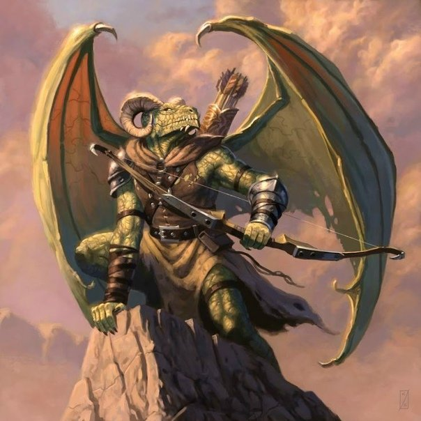
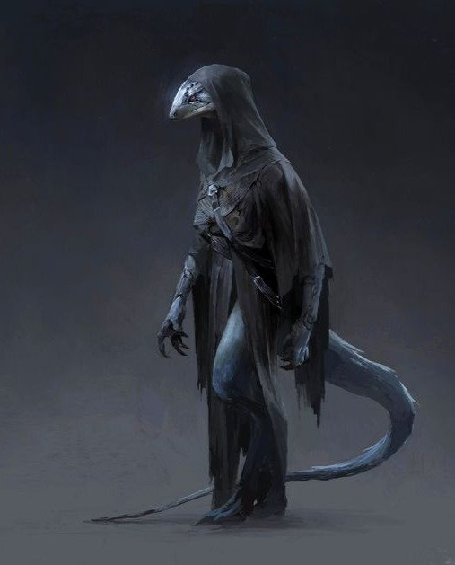
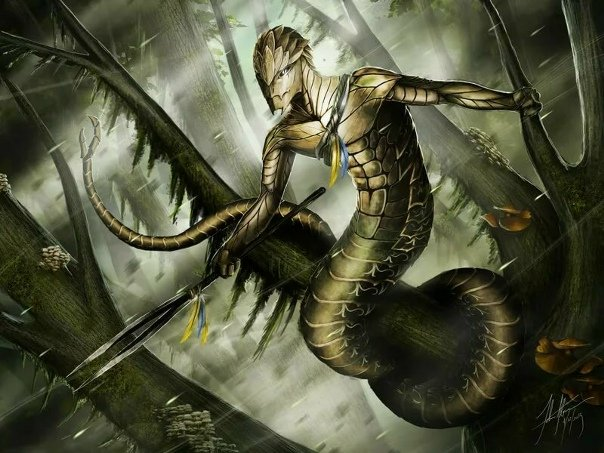
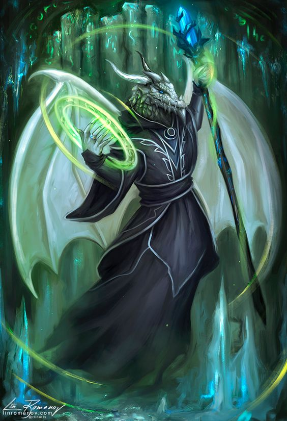

title: Ящеры
parent: rasy
order: 140
icon: bi-person
image: photo/vk/533473434_457251163.jpg
layout: race
art: photo/race/yaschery-card.jpg
art_position: center 25%
group: Другие расы
vk: 54761829

## Общее описание

Чудом эволюционировавшие в разумных существ рептилии очень долго населяли только западную часть Бранна, не встречаясь нигде более. Благодаря людям, которые вторглись к ним и по сути захватили, они одновременно смогли и очень сильно развиться вперёд. И теперь ящеры — одни из тех, чьё государство активно бороздит моря. О них знают всё больше по всему миру, и у молодой расы всё только впереди.

## Названия

Ящеры, ящеролюды.

## Внешность, строение и особенности

Ящеры достаточно долгоживущие существа, также имеющие довольно большое разнообразие внутри своей расы. Они яйцекладущие существа, и в одной кладке может быть до 5-ти яиц. Однако выживает после вылупления не больше 2 детей. Рождаются они совсем крошечными, очень быстро вырастая в первые годы жизни, как говорится, буквально по часам.
Магический потенциал у них чуть ниже человеческого, зато обучиться они способны любому типу магии одинаково хорошо, к тому же на них самих магия имеет более слабое воздействие, что позволяет использовать различные техники, которые обычно способны наносить вред и самому заклинателю.
Все ящеры обладают прочной чешуей, скрывающей нежную кожу. Она способна защитить своего владельца от ударов меча, который по большей части скользит по плотно прилегающей чешуе, или просто ломает сами чешуйки, что не особо доставляет дискомфорта самому ящеру. Сама чешуя может иметь самые разнообразные цвета, от чёрных до ярко-красных. Подобно их менее разумным родичам, они линяют, причём постоянно в течение жизни. Происходит этот процесс постепенно, не особо доставляя дискомфорта, не считая необходимости убирать тусклые чешуйки, место которых занимают яркие и крепкие пластинки. Полностью чешуя сменяется за 6 лет.
Жившие лишь в западных, тёплых частях Бранна, где не было холодов, они очень плохо переносят этот самый холод. Он очень негативно сказывается на их теле и может иметь плохие последствия для организма. При длительном нахождении в прохладном пространстве, с температурой ниже 5-ти градусов, тело начинает переходить в менее активный режим. Ящер способен в этом состоянии ограничивать себя в еде около месяца, однако он становится достаточно медлителен, падает скорость рефлексов, также появляются проблемы со сном, не считая постоянной борьбы с возникающими болезнями. Также могут возникнуть проблемы со зрением, так как их глаза постоянно очень влажные, и образовывающиеся кристаллики начинают лопать кровяные сосуды. Если температура падает ниже минус 20 градусов, организм впадает в состояние анабиоза до 3-х месяцев. Бесследно он не проходит, зачастую после анабиоза у ящера навсегда остаются проблемы со зрением, вплоть до полной его потери, а также проблемы в виде хронических болезней.
Ящеролюди способны дышать под водой и пользоваться растворённым в ней кислородом. Кровь их имеет синеватый цвет и достаточно водянистая, не столь густая, как у человека. Лицо вытянутое, имеет очень мощную челюсть с рядами острых зубов, которая способна без проблем лишить человека кисти. Глаза ящеров имеют специальную плёнку, защищающую глаза, в том числе под водой. Они очень редко и медленно моргают, смачивая так свои глаза.
Среди ящеров выделяют 3 основных подвида, самый распространённый из них — обычные человекоподобные ящеры. Их рост составляет около 180 сантиметров, а мощный хвост достигает 80 сантиметров. Ноги этих ящеров оканчиваются двумя мощными пальцами, из-за чего они не имеют стоп. На конце этих ног крючковидные когти 10 сантиметров, способные спокойно вспороть какую-нибудь тушку. Когти растут и на пальцах рук, до 5 сантиметров, но почти всегда состригаются. Иногда у них вырастают рудименты типа рогов, которые усеивают голову. Также это самые долгоживущие ящеры, способные протянуть больше 200 лет максимум.
Живут в среднем от 42 до 65 лет _(с учётом всех факторов типа детской смертности)_. Ящер, выросший до самостоятельного возраста, живёт в среднем 105-180 лет. Максимальный возраст жизни 200 лет.

Сильнее всех выделяются змееподобные, или, как ещё говорят, нагоподобные ящеры. В отличие от остальных они не имеют ног, а тело продолжается массивным хвостом. В длину они могут достигать 3 метров. Хвост даёт им очень большую мобильность как на суше, так и в воде. Они могут развивать скорость до 20 метров в секунду, свободно преодолевая любые препятствия, и даже взбираясь на деревья. Также он даёт такую прекрасную функцию, как удушение неприятеля. Взрослый ящер способен легко сломать рёбра человеку своей хваткой. Также у них самые прочные пластины чешуи, которые также намного больше, особенно на брюшке, благодаря чему им ещё и несколько удобнее делать доспехи. Змее- или нагоподобными их называют из-за того, что у них могут быть как капюшоны, обрамляющие голову, как у змей, так и выросты, напоминающие плавники. Живут они меньше всех ящеров, максимально около 80 лет.

Последний тип ящеров отличается парой крупных крыльев за спиной, дающих отличный манёвр в виде полётов. При этом они самые мелкие среди всех ящеров, достигая роста всего около 160 сантиметров, дабы крылья могли держать их в воздухе с их меньшей массой. Держать их в воздухе крылья могут около часа беспрерывного размеренного полёта, чего обычно более чем достаточно для различных целей. Размах крыльев может достигать 4 метров и даже более. Выделяются они и тем, что у них шипы могут перерастать в полноценные рога. В остальном же они схожи с человекоподобными ящерами.

## Культура, типичное поведение, положение среди остальных и места обитания

Ящеры основной массой находятся в западной части Бранна, как и их государство. Некоторые выезжают за море, оставаясь в других странах, особенно выделяющихся ещё более тёплым климатом. Переняв от людей часть своей культуры и получив толчок для её самостоятельного развития, они не ухватили лишь наличие общей веры в какого-то отдельного бога. Для каждого это индивидуальное дело, и порицаться или одобряться обществом ящеров вера в кого-то не будет. Сильнее всего они ухватили аристократичность, активно уходя от первобытной племенной жизни. Беззаботная жизнь, когда у тебя множество денег, постоянная безопасность — нынешний идеал для ящеров, к которому многие пытаются стремиться разными способами. Поэтому многие стали также быстро осваиваться в торговле, каких-то делах, политике.
Несмотря на то, как себя люди повели с ящерами, последние даже не обладают открытой нетерпимостью в их адрес. Так, можно встретить до сих пор стоящие статуи выдающихся людских императоров ещё со времён Громула, которые не сносятся ящерами. К людям многие также относятся сугубо нейтрально, так как у ящеров сейчас нет в целях какой-либо вражды.
Сами по себе они существа довольно трудолюбивые, редко ведомые какими-либо корыстными мыслями. Особенно сильно выделяются в этом плане ящеры, ушедшие в горы, в добровольное отшельничество с целью познания себя. От животного прошлого мало что осталось, можно сказать, они одни из самых цивилизованных существ на данный момент, ценящих как свою, так и чужую свободу.
У ящеролюдов имеется много традиций, присущих только им, по типу обязательного наличия в доме бассейна, или иного водоёма, с постоянно сменяемой водой. Вода при этом даже не является жизненно необходимой вещью для ящеров, чтобы постоянно в ней находиться, это просто самое приятное времяпрепровождение по мнению многих. Также именно в таких бассейнах развиваются и их яйца, и детёныши, пока они не становятся более самостоятельными.
